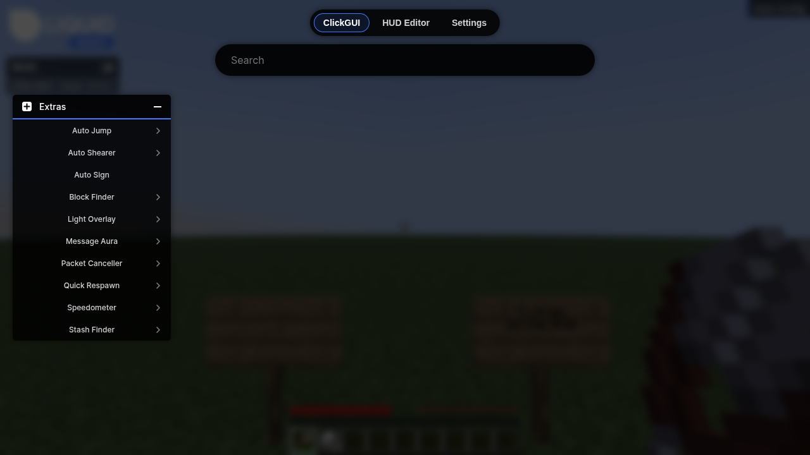
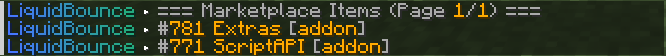
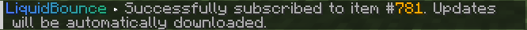
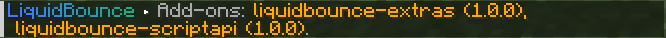
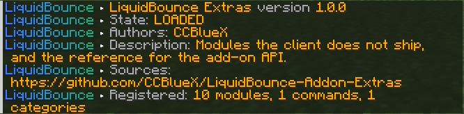
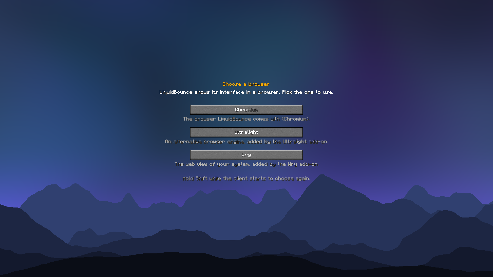

## Using Add-ons

Add-ons add new things to LiquidBounce: modules, commands, HUD components and even new module categories. Their categories show up in the [ClickGUI](/docs/usage/clickgui) next to the built-in ones:

[Scripts](/docs/script-api/installation) are another way to add features. To run them, you need the Script API add-on.

> An add-on can do anything the client can do on your computer. Only install add-ons from the Marketplace or from developers you trust.

### Installing Add-ons

In [LiquidLauncher](/docs/get-started/liquidlauncher#client), open the **Client** tab in the settings, click **Browse** next to **Add-ons** and pick one. The launcher installs it for the next start, together with any add-ons and scripts it needs.

You can also do it from the chat in game:

1. **See which add-ons there are**: `.marketplace list addon`

   

2. **Install one**: `.marketplace subscribe <add-on>`
   - You can type `author/name`, just the name, or its ID. The chat suggests popular add-ons
   - The add-on is downloaded for the next start, together with the add-ons and scripts it needs

   

3. **Restart the game**
   - Add-ons only load when LiquidBounce starts, so a new or updated add-on works after a restart
   - `.addon list` then shows it, and `.addon info <name>` shows what it added

   

   

### Updating and Removing

Your add-ons update every time the client starts. `.marketplace update` updates them right away, and the new version is used after the next restart. `.marketplace unsubscribe <add-on>` removes an add-on; the chat suggests the ones you have.

Each version of an add-on is made for one Minecraft version, so you only get versions that fit the game you are playing. If no version fits, the add-on stays on your list but is not installed. It comes back once a fitting version is out.

### Official Add-ons

- **[Extras](https://github.com/CCBlueX/LiquidBounce-Addon-Extras)**: extra modules that LiquidBounce does not come with. Install with `.marketplace subscribe Extras`
- **[Script API](https://github.com/CCBlueX/LiquidBounce-Addon-ScriptAPI)**: runs [scripts](/docs/script-api/installation). Install with `.marketplace subscribe ScriptAPI`
- **Ultralight**: a small, light browser for the client's menus. Install with `.marketplace subscribe Ultralight`
- **[Wry](https://github.com/CCBlueX/LiquidBounce-Addon-Wry)**: shows the client's menus with the browser built into your system (WebView2 on Windows, WebKit on macOS, WebKitGTK on Linux). Install with `.marketplace subscribe Wry`

### Choosing a Browser

The title screen, the ClickGUI and the HUD are web pages. LiquidBounce shows them with the Chromium browser it comes with. When an add-on such as Ultralight or Wry adds another browser, the client asks you which one to use when it starts:

Your choice is saved. To choose again, hold **SHIFT** while the client starts. If you remove the add-on, LiquidBounce uses Chromium again.

Wry needs your system's web view. Windows 11 and updated Windows 10 already have it. On Linux, install WebKitGTK, for example with `sudo pacman -S webkit2gtk-4.1` or `sudo apt install libwebkit2gtk-4.1-0`.

### Making Your Own

The [Developers](/docs/add-on-api/developers/getting-started) section shows how to write an add-on in Kotlin or Java and put it on the Marketplace.

---

*Last updated: 2026-11-11, based on [source code](https://github.com/CCBlueX/LiquidBounce/blob/d0486b17c/src/main/kotlin/net/ccbluex/liquidbounce/features/command/commands/client/marketplace/CommandMarketplace.kt)*
