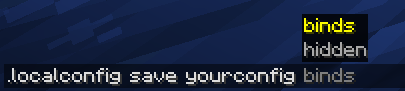
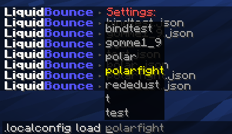

## Local Config
Besides the configs on the Marketplace, you can save your own settings to a file on your computer. You can load that file again later, or send it to a friend.

### How to manage your local configurations

#### `.localconfig save <name> [overwrite] [include]`
Saves all your current settings in a file called `<name>`, in the LiquidBounce configs folder.

If a config with that name already exists, it is not replaced. Add `true` after the name to replace it.

Some things are left out unless you ask for them. After `true` or `false`, list what to add, separated by commas:

- `binds`: the keys your modules are bound to
- `hidden`: which modules are hidden from the module list
- `render`: modules from the Render category
- `fun`: modules from the Fun category

For example, `.localconfig save pvp false binds,render` saves a config called `pvp` with your binds and render modules.

To share a config, send the file to someone. They put it in their configs folder and load it with the command below.

#### `.localconfig load <name> [modules]`
Loads a config from your configs folder. Replace `<name>` with the name of the file. To load only the settings of some modules, add their names, separated by commas.

#### `.localconfig`
Lists your saved configs. Click one to load it.

#### `.localconfig browse`
Opens the folder with your local configs (usually `%AppData%/CCBlueX/LiquidLauncher/gameDir/nextgen/LiquidBounce/configs`).

The AutoConfig module only uses configs from the Marketplace, not your local ones.

---

*Last updated: 2026-11-11, based on [source code](https://github.com/CCBlueX/LiquidBounce/blob/d0486b17c/src/main/kotlin/net/ccbluex/liquidbounce/features/command/commands/client/CommandLocalConfig.kt)*
