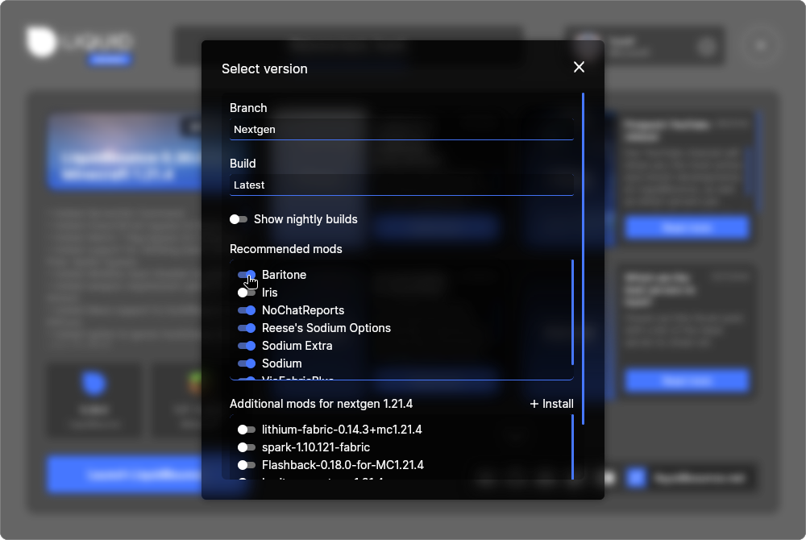
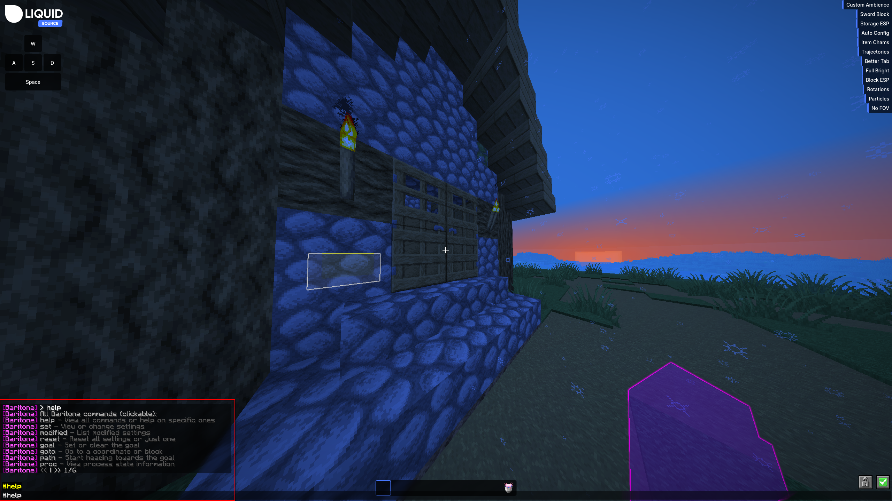

# Baritone with LiquidBounce

## What is Baritone?

Baritone is a mod that walks through the world for you. You tell it where to go or what to do, and it finds the way by itself. It can mine blocks you pick, build things, follow players and more.

## Installation

### Installing Baritone with LiquidLauncher (Recommended)

With LiquidLauncher, you only need to tick a box:

1. **Download and Install LiquidLauncher** from [here](https://liquidbounce.net/download).
2. **Open LiquidLauncher** and sign in with your Minecraft account.
3. **Find the mod list:**
   - Click the **Version Selection** field at the bottom left.
    
    
4. **Enable Baritone:**
   - In the Recommended Mods list, find and enable **Baritone**.
   
   
5. **Launch LiquidBounce:**
   - Baritone is installed for you and ready to use.

### Manual Installation (JAR download)

If you don't use LiquidLauncher or need a certain Baritone version, download the JAR file for your Minecraft version here:

| Forge                                                                                                         | Fabric                                                                                                          | NeoForge                                                                                                            |
|---------------------------------------------------------------------------------------------------------------|-----------------------------------------------------------------------------------------------------------------|---------------------------------------------------------------------------------------------------------------------|
| [1.12.2 Forge](https://github.com/cabaletta/baritone/releases/download/v1.2.19/baritone-api-forge-1.2.19.jar) |                                                                                                                 |                                                                                                                     |
| [1.16.5 Forge](https://github.com/cabaletta/baritone/releases/download/v1.6.5/baritone-api-forge-1.6.5.jar)   | [1.16.5 Fabric](https://github.com/cabaletta/baritone/releases/download/v1.6.5/baritone-api-fabric-1.6.5.jar)   |                                                                                                                     |
| [1.17.1 Forge](https://github.com/cabaletta/baritone/releases/download/v1.7.3/baritone-api-forge-1.7.3.jar)   | [1.17.1 Fabric](https://github.com/cabaletta/baritone/releases/download/v1.7.3/baritone-api-fabric-1.7.3.jar)   |                                                                                                                     |
| [1.18.2 Forge](https://github.com/cabaletta/baritone/releases/download/v1.8.6/baritone-api-forge-1.8.6.jar)   | [1.18.2 Fabric](https://github.com/cabaletta/baritone/releases/download/v1.8.6/baritone-api-fabric-1.8.6.jar)   |                                                                                                                     |
| [1.19.2 Forge](https://github.com/cabaletta/baritone/releases/download/v1.9.4/baritone-api-forge-1.9.4.jar)   | [1.19.2 Fabric](https://github.com/cabaletta/baritone/releases/download/v1.9.4/baritone-api-fabric-1.9.4.jar)   |                                                                                                                     |
| [1.19.3 Forge](https://github.com/cabaletta/baritone/releases/download/v1.9.1/baritone-api-forge-1.9.1.jar)   | [1.19.3 Fabric](https://github.com/cabaletta/baritone/releases/download/v1.9.1/baritone-api-fabric-1.9.1.jar)   |                                                                                                                     |
| [1.19.4 Forge](https://github.com/cabaletta/baritone/releases/download/v1.9.5/baritone-api-forge-1.9.5.jar)   | [1.19.4 Fabric](https://github.com/cabaletta/baritone/releases/download/v1.9.5/baritone-api-fabric-1.9.5.jar)   |                                                                                                                     |
| [1.20.1 Forge](https://github.com/cabaletta/baritone/releases/download/v1.10.3/baritone-api-forge-1.10.3.jar) | [1.20.1 Fabric](https://github.com/cabaletta/baritone/releases/download/v1.10.3/baritone-api-fabric-1.10.3.jar) |                                                                                                                     |
| [1.20.3 Forge](https://github.com/cabaletta/baritone/releases/download/v1.10.4/baritone-api-forge-1.10.4.jar) | [1.20.3 Fabric](https://github.com/cabaletta/baritone/releases/download/v1.10.4/baritone-api-fabric-1.10.4.jar) | [1.20.3 NeoForge](https://github.com/cabaletta/baritone/releases/download/v1.10.4/baritone-api-neoforge-1.10.4.jar) |
| [1.20.4 Forge](https://github.com/cabaletta/baritone/releases/download/v1.10.4/baritone-api-forge-1.10.4.jar) | [1.20.4 Fabric](https://github.com/cabaletta/baritone/releases/download/v1.10.4/baritone-api-fabric-1.10.4.jar) | [1.20.4 NeoForge](https://github.com/cabaletta/baritone/releases/download/v1.10.4/baritone-api-neoforge-1.10.4.jar) |
| [1.21.1 Forge](https://github.com/cabaletta/baritone/releases/download/v1.11.2/baritone-api-forge-1.11.2.jar) | [1.21.1 Fabric](https://github.com/cabaletta/baritone/releases/download/v1.11.2/baritone-api-fabric-1.11.2.jar) | [1.21.1 NeoForge](https://github.com/cabaletta/baritone/releases/download/v1.11.2/baritone-api-neoforge-1.11.2.jar) |
| [1.21.3 Forge](https://github.com/cabaletta/baritone/releases/download/v1.11.1/baritone-api-forge-1.11.1.jar) | [1.21.3 Fabric](https://github.com/cabaletta/baritone/releases/download/v1.11.1/baritone-api-fabric-1.11.1.jar) | [1.21.3 NeoForge](https://github.com/cabaletta/baritone/releases/download/v1.11.1/baritone-api-neoforge-1.11.1.jar) |
| [1.21.4 Forge](https://github.com/cabaletta/baritone/releases/download/v1.13.1/baritone-api-forge-1.13.1.jar) | [1.21.4 Fabric](https://maven.ccbluex.net/releases/baritone/baritone-fabric/1.21.4-1.13.0/baritone-fabric-1.21.4-1.13.0.jar)* | [1.21.4 NeoForge](https://github.com/cabaletta/baritone/releases/download/v1.13.1/baritone-api-neoforge-1.13.1.jar) |
| [1.21.5 Forge](https://github.com/cabaletta/baritone/releases/download/v1.14.0/baritone-api-forge-1.14.0.jar) | [1.21.5 Fabric](https://github.com/cabaletta/baritone/releases/download/v1.14.0/baritone-api-fabric-1.14.0.jar) | [1.21.5 NeoForge](https://github.com/cabaletta/baritone/releases/download/v1.14.0/baritone-api-neoforge-1.14.0.jar) |
| [1.21.6 Forge](https://github.com/cabaletta/baritone/releases/download/v1.15.0/baritone-api-forge-1.15.0.jar) | [1.21.6 Fabric](https://github.com/cabaletta/baritone/releases/download/v1.15.0/baritone-api-fabric-1.15.0.jar) | [1.21.6 NeoForge](https://github.com/cabaletta/baritone/releases/download/v1.15.0/baritone-api-neoforge-1.15.0.jar) |
| [1.21.7 Forge](https://github.com/cabaletta/baritone/releases/download/v1.15.0/baritone-api-forge-1.15.0.jar) | [1.21.7 Fabric](https://github.com/cabaletta/baritone/releases/download/v1.15.0/baritone-api-fabric-1.15.0.jar) | [1.21.7 NeoForge](https://github.com/cabaletta/baritone/releases/download/v1.15.0/baritone-api-neoforge-1.15.0.jar) |
| [1.21.8 Forge](https://github.com/cabaletta/baritone/releases/download/v1.15.0/baritone-api-forge-1.15.0.jar) | [1.21.8 Fabric](https://github.com/cabaletta/baritone/releases/download/v1.15.0/baritone-api-fabric-1.15.0.jar) | [1.21.8 NeoForge](https://github.com/cabaletta/baritone/releases/download/v1.15.0/baritone-api-neoforge-1.15.0.jar) |
| | [1.21.11 Fabric](https://maven.ccbluex.net/releases/baritone/baritone-fabric/1.21.11-1.11.1-12-g2748d587/baritone-fabric-1.21.11-1.11.1-12-g2748d587.jar)* | |

*This is an unofficial version.

### Manual Installation Steps

To install Baritone manually:

1. [Download](https://fabricmc.net/use/installer/) and install the latest version of the Fabric mod loader on your system if you haven't already.
2. Run the Minecraft launcher, switch to the *Installations* tab, hover over the Fabric profile and press the folder icon to the right of the "Play" button. This opens your Minecraft folder.
3. If you don't see a folder called *mods*, create it.
4. Download the correct version of Baritone for your Minecraft version and mod loader from the table above.
5. Place the downloaded Baritone JAR file in the *mods* directory.
6. If you use it with LiquidBounce, make sure [Fabric API](https://modrinth.com/mod/fabric-api/) and [Fabric Language Kotlin](https://modrinth.com/mod/fabric-language-kotlin) are also installed in your *mods* folder.
7. Start Minecraft with the Fabric profile and check that both LiquidBounce and Baritone work.

## Verifying Installation

Type `#help` in the chat. If Baritone is installed, it answers with its list of commands, and you may already see suggestions while typing.

