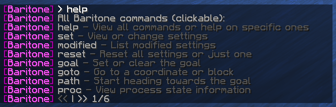

# How to use Baritone

All Baritone commands start with `#`, like `#goal` or `#mine`. That's how Baritone knows a chat message is meant for it.

> **Note:** You type the commands in the normal chat. Watch out for typos: a mistyped command is sent to public chat.

## Basic Command Usage

<video src="/images/baritone/commands/usage.mp4" controls width="600">Your browser does not support the video tag.</video>

To use Baritone commands:
1. Open the Minecraft chat (default: press 'T' key)
2. Type a command starting with `#` 
3. Press Enter

## Essential Commands

### Getting Help



```
#help
```

Shows every Baritone command. Click a command to learn more about it.

### Basic Navigation

```
#stop
```
Stops whatever Baritone is doing right away.

```
#click
```
Lets you click where you want to go. Right click to walk on top of a block, left click to walk into it.

## Troubleshooting

### Baritone Isn't Responding to Commands
- Check that Baritone is installed (see [Installation](/docs/baritone/installation))
- Check that your commands start with `#`

### Baritone Gets Stuck Frequently
- Change the pathfinding [settings](/docs/baritone/usage/settings)
- Very rough terrain is hard for Baritone, so try from somewhere easier
- Use `#cancel` and try again from another spot

### Poor Performance
- Turn off `renderPath` and `renderGoal`
- Use closer goals or shorter paths
- Give Minecraft more RAM (see [Fixing FPS](/docs/troubleshooting/fixing-fps))

## Additional Resources

- [Official Baritone GitHub](https://github.com/cabaletta/baritone)
- [Baritone Discord Server](http://discord.gg/s6fRBAUpmr)
- [In-depth usage guide](https://github.com/cabaletta/baritone/blob/1.19.4/USAGE.md)
