# How to install LiquidBounce

This guide shows you how to install LiquidBounce with LiquidLauncher. It is the easiest way to get started.

## System Requirements

- Windows 10/11 (x86_64, arm64)*
- macOS 11 or greater (Intel, Apple Silicon)
- GNU Linux glibc 2.31 or greater (x86_64, arm64)**
- 4GB of RAM (8GB recommended)
- Internet connection

## Installation Process

### 1. Download the LiquidLauncher

1. Visit the [LiquidBounce download page](https://liquidbounce.net/download)
2. Select your operating system (e.g., Windows)
   
   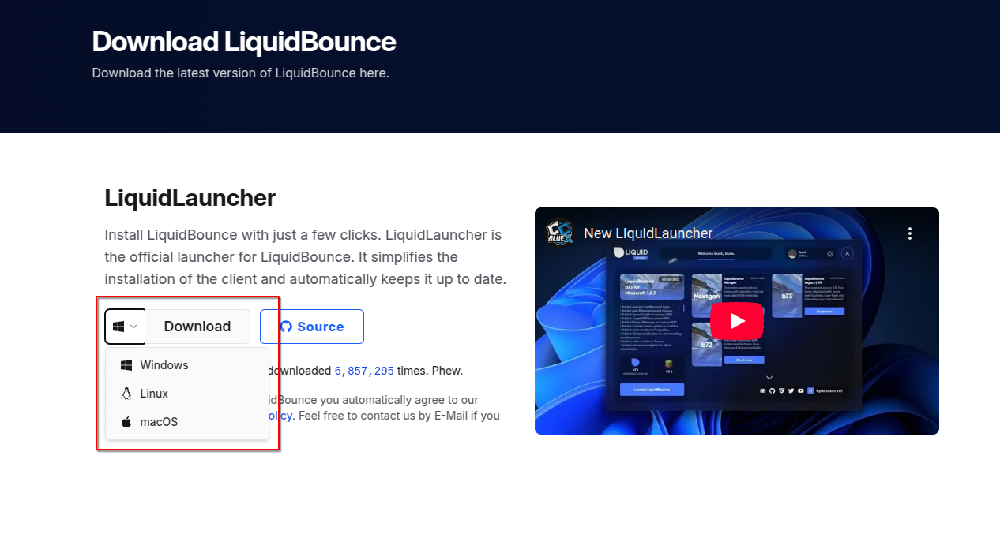

3. Choose your preferred installer type (MSI recommended for Windows)
   
   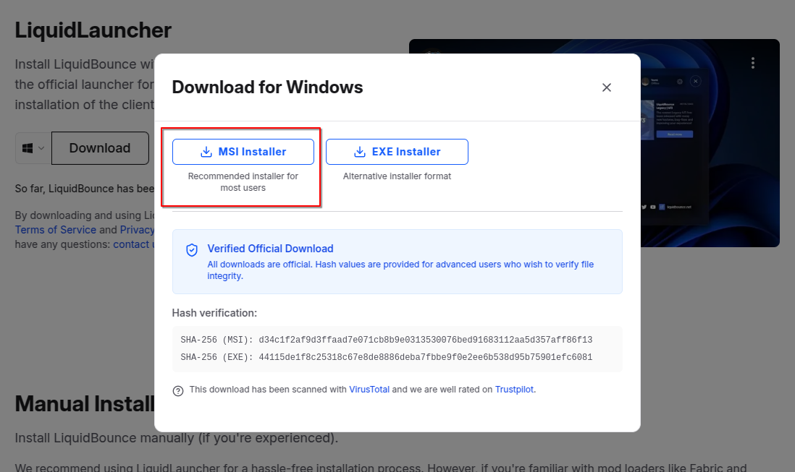

4. When prompted by your browser, click "Open" to launch the installer directly
   
   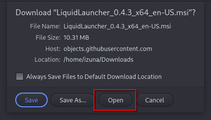

### 2. Install the LiquidLauncher

Follow the installation wizard that appears:

1. Click through the welcome screen
   
   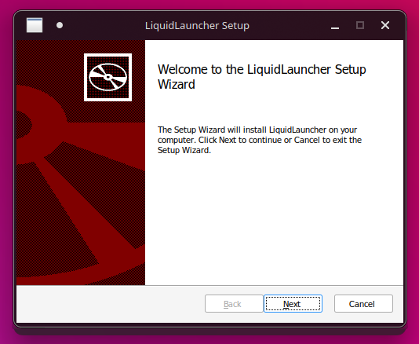

2. Accept the license agreement
   
   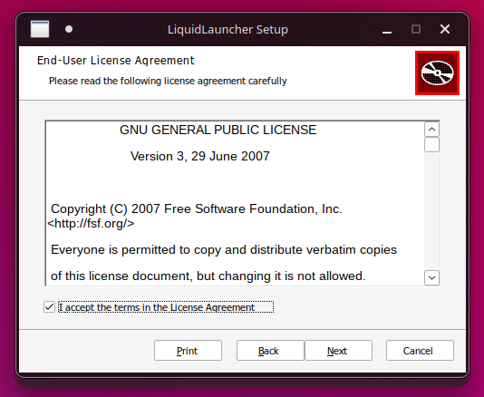

3. Choose installation location (default is recommended)
   
   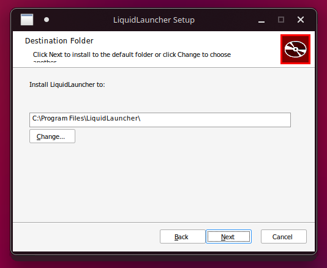

4. Complete the installation process
   
   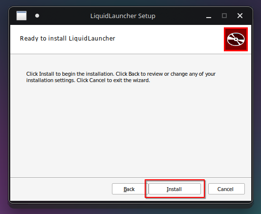
   
   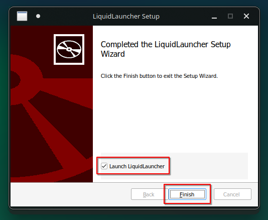

### 3. Sign-In Into Your Account

1. Open LiquidLauncher after installation completes
   
   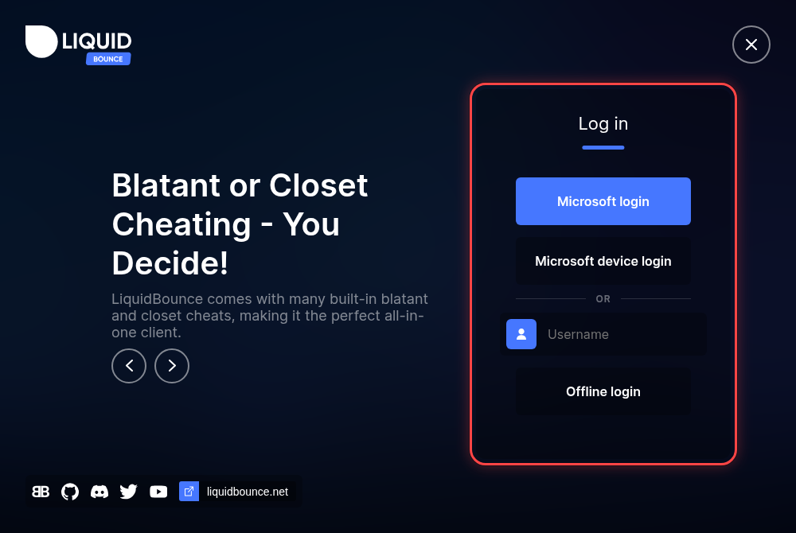

2. Choose how to log in:
   - *Microsoft Login* is for players who bought Minecraft. Use this if you can.
   - *Offline Mode* is for players without a bought account. You can only join servers that do not check accounts (servers with online mode turned off).

3. If you selected Microsoft Login:
   - Click "Microsoft login" and sign in in the window that opens, or click "Microsoft device login" to sign in on another device
   
   
   
   - The device login shows a code
   
   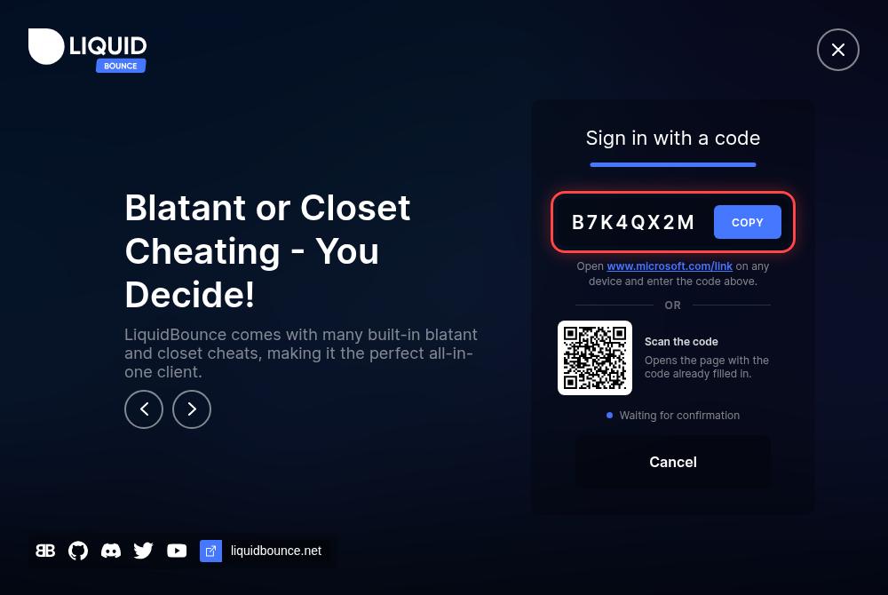
   
   - Visit [microsoft.com/link](https://microsoft.com/link) on any device, or scan the QR code
   - Enter the code shown in the launcher
   - Press "Allow access" to continue
   - Sign in with your Microsoft account
   - Grant permission for LiquidLauncher to access your Xbox Live profile
   
   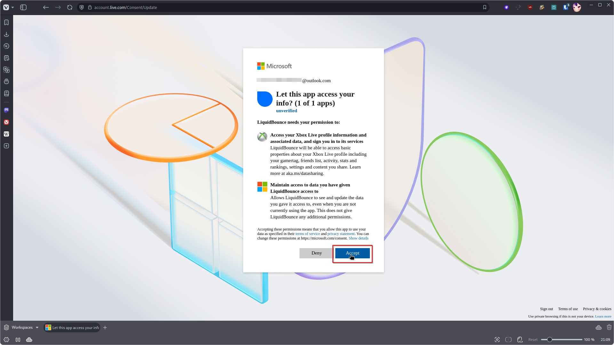

   > LiquidBounce never gets full access to your Microsoft account. It only sees your Xbox Live profile, which Minecraft needs to log you in. Your login is only saved on your own computer.
   >
   > You can read what other players think about us on [Trustpilot](https://www.trustpilot.com/review/liquidbounce.net).

### 4. Launch LiquidBounce

1. Once logged in, click the "Launch LiquidBounce" button
   
   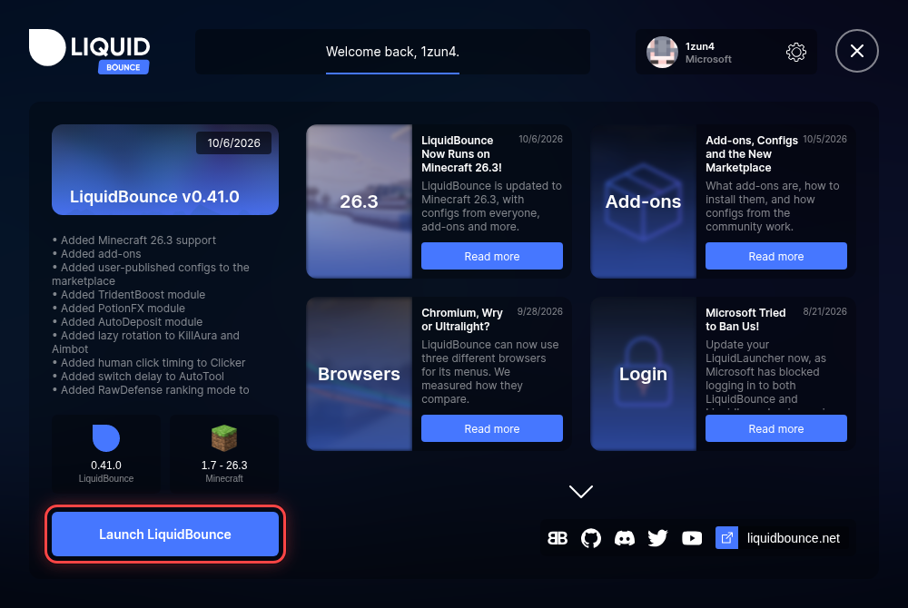

2. The first time, you see an advertisement page. Ads help pay for LiquidBounce.
   
   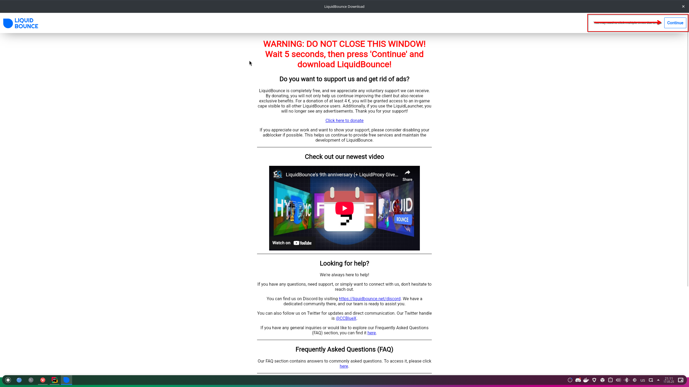
   
3. Click "Continue" in the top right corner
   
   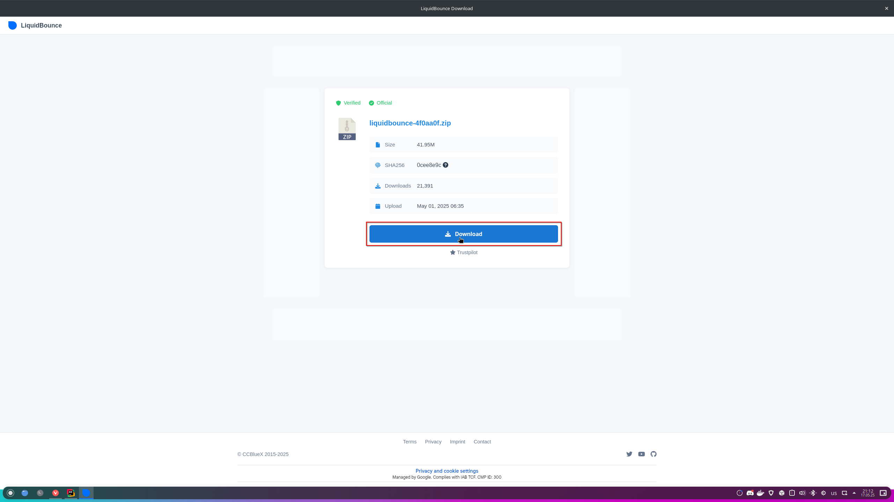
   
4. Click "Download" to begin downloading LiquidBounce
   
5. The launcher downloads Minecraft and everything LiquidBounce needs
   
   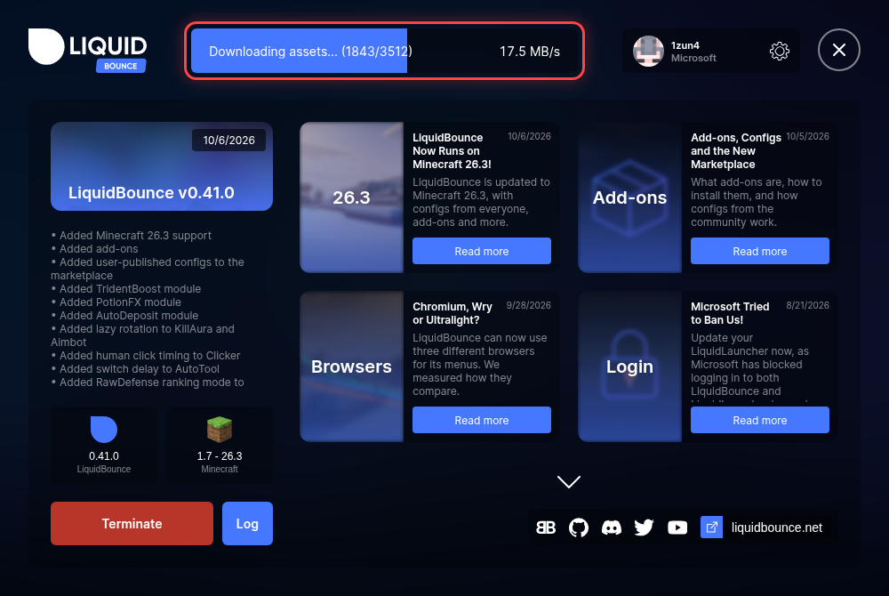

### 5. First Launch

1. LiquidBounce starts and downloads a few more things:
   - Chromium, which draws the menus
   - Deep Learning files for modules that use AI
   
   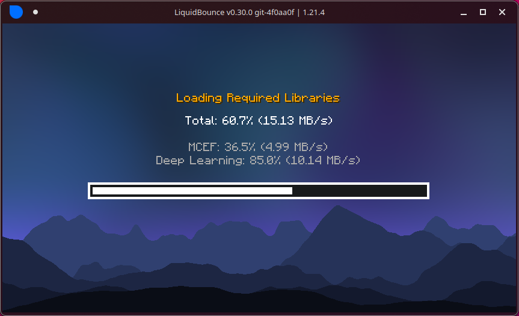
   
   > Deep Learning does not work on every computer. If yours is not supported, this step is skipped.

2. When it is done, you see the LiquidBounce main menu.
   
   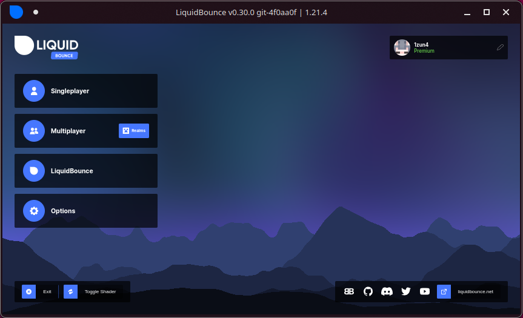

## Next Steps

LiquidBounce is now installed. To learn how to use it, start with the introduction and then read these guides:

- [Introduction](/docs/usage/introduction)
- [Using the Account Manager](/docs/usage/account-manager)
- [Using the ClickGUI](/docs/usage/clickgui)

## Manual Installation

If you do not want to use LiquidLauncher, you can install LiquidBounce by hand. See the [Manual Installation Guide](/docs/get-started/manual-installation).

---

\* Windows 10/11 support may vary based on system configuration  
\** Some Linux distributions may require additional configuration
