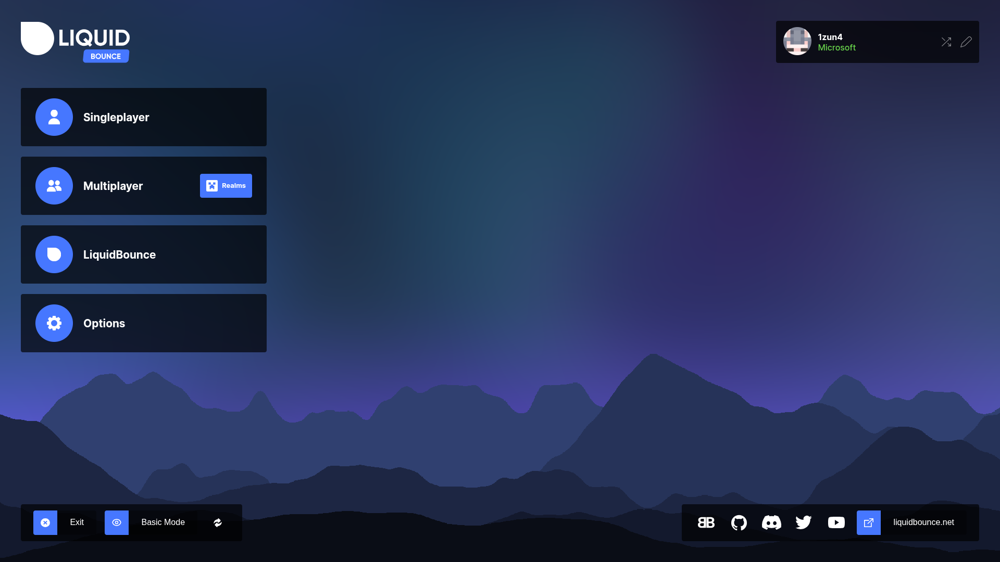

# How to install LiquidBounce manually

This guide shows you how to install LiquidBounce by hand. It assumes you already have Minecraft and use the official Minecraft launcher from Mojang. With another launcher, some steps look a bit different.

## Installing LiquidBounce

    <iframe width="560" height="315" src="https://www.youtube.com/embed/i_r1i4m-NZc?si=eQlG3oC_3d1Vbp25" title="YouTube video player" frameborder="0" allow="accelerometer; autoplay; clipboard-write; encrypted-media; gyroscope; picture-in-picture; web-share" referrerpolicy="strict-origin-when-cross-origin" allowfullscreen></iframe>

LiquidBounce Nextgen is the version we work on. It is based on Minecraft 26.3, and with ViaFabricPlus (see below) you can join servers on older versions too. To install it by hand:

1. [Download](https://fabricmc.net/use/installer/) and install the latest version of the Fabric mod loader on your system.
2. Run the Minecraft launcher, switch to the *Installations* tab, hover over the profile the Fabric installer just created and press the directory icon that appeared to the right of the button labeled *Play*. This will open the Minecraft installation directory in your file explorer.
3. If you do not see a folder called *mods*, create it.
4. [Download](/download) the latest version of LiquidBounce Nextgen from the section called *Manual Installation* (press *Show nightly builds* to see pre-releases).
5. Extract the jar file from the archive you just downloaded to the *mods* directory.
6. Download [Fabric API](https://modrinth.com/mod/fabric-api/) and [Fabric Language Kotlin](https://modrinth.com/mod/fabric-language-kotlin) and place them in the *mods* directory as well.
7. In the launcher, pick the Fabric profile and press Play. LiquidBounce should now start.

### Installing recommended mods

We recommend these mods together with LiquidBounce. Download them and put them in the *mods* folder, just like LiquidBounce.

- [Sodium](https://modrinth.com/mod/sodium) makes the game run much faster.
- [ViaFabricPlus](https://modrinth.com/mod/viafabricplus) lets you join servers on Minecraft 1.7 and newer.
- [No Chat Reports](https://modrinth.com/mod/no-chat-reports/versions) stops other players from reporting your chat messages.

