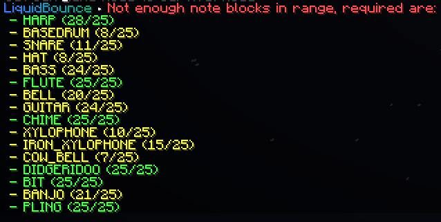

## Notebot

Notebot plays songs on note blocks for you. Pick an NBS song file (made with [Note Block Studio](https://opennbs.org/)), stand near enough note blocks and turn it on. Notebot first tests which sound each block makes, then tunes them, then plays the song. It tells you in chat how far along it is and turns off when the song ends.

You have to be in Survival mode, and [PacketMine](/docs/modules/world/packetmine) has to be off. The block under a note block decides its instrument, so place the right blocks under them. If you don't have enough note blocks in reach, Notebot turns off and lists the missing instruments in chat.

Note blocks need an empty block above them, or they make no sound. Notebot clicks a lot of blocks very fast, so a high ping or a strict server can kick you.

While it works, Notebot colors the note blocks: red while testing, yellow while tuning, and your chosen color while playing.

**Category:** Fun
**Enabled by default:** No

### Settings

| Setting | Type | Default | Range | Description |
|---|---|---|---|---|
| Song | File |  | .nbs | The song file to play. |
| PianoOnly | Toggle | false |  | Plays every note as piano, so you only need note blocks with the piano sound. |
| ReuseBlocks | Toggle | true |  | Lets one note block play the same note more than once, so you need fewer blocks. Two of the same note at the same moment may play as one. Changing this turns Notebot off. |
| Range | Decimal | 6.0 | 1.0..6.0 | How far away (in blocks) note blocks can be. |
| IgnoreOpenInventory | Toggle | true |  | Keeps playing while you have your inventory open. |
| StartDelay → Test | Integer | 0 | 0..20 ticks | How long to wait before testing starts, in ticks (20 per second). |
| StartDelay → Tune | Integer | 0 | 0..20 ticks | How long to wait before tuning starts. |
| StartDelay → Play | Integer | 2 | 0..20 ticks | How long to wait before the song starts. |
| Render | Toggleable Group | On |  | Colors the note blocks. See [Shared: Placement Rendering](/docs/modules/shared-settings/placement-rendering). |
| Render → TestColor | Color | Red, see-through |  | Fill color while testing. |
| Render → TestOutlineColor | Color | Red |  | Outline color while testing. |
| Render → TuneColor | Color | Yellow, see-through |  | Fill color while tuning. |
| Render → TuneOutlineColor | Color | Yellow |  | Outline color while tuning. |

---
*Last updated: 2026-11-11, based on [source code](https://github.com/CCBlueX/LiquidBounce/blob/d0486b17c/src/main/kotlin/net/ccbluex/liquidbounce/features/module/modules/fun/notebot/ModuleNotebot.kt)*
