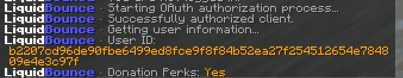

## Setting up premium cosmetics

The following tutorial will guide you through the process of setting up your premium cosmetics. If you have not purchased premium yet, you can do so [here](https://liquidbounce.net/premium).

### Instructions for LiquidBounce Nextgen (recommended)

1. Link your premium purchase to a [LiquidBounce account](https://liquidbounce.net/premium). See [here](/docs/premium/launcher-setup) for more information. You can also customize your cosmetics in the user panel.
2. Launch LiquidBounce.
3. Join a server or a singleplayer world.
4. Send `.client account login` into the chat.
5. A browser window should open. Login to your LiquidBounce account. Finish the login within five minutes, otherwise it times out and you have to send the command again. Sending the command again while a login is still pending simply opens the same page once more instead of starting a second login.
6. If everything went accordingly, you should now be logged in and your cosmetics should be enabled. Make sure it says `Premium Features: Yes` in the chat message.

> **Note:** LiquidBounce and LiquidLauncher share the same LiquidBounce account login. If you already signed in with your LiquidBounce account in the launcher, the client picks that login up and you can skip the steps above; likewise, signing in with `.client account login` also signs you in in the launcher.

Deadmau5 ears use their own texture instead of your skin. In the user panel you can let them match your cape (the default), pick a style, upload a texture or choose a colour. You can also pick or upload a custom elytra, which replaces your cape texture on the elytra.

### Instructions for LiquidBounce Legacy

**Note:** LiquidBounce Legacy only supports capes. Other premium cosmetics like Deadmau5 ears are only available in LiquidBounce Nextgen.

1. Launch LiquidBounce.
2. In the main menu, press the button labeled `Alt Manager`.
3. To the right, press the button labeled `Cape`.
4. Enter your transfer code in the field called `Token` and press `Login`. You can find this token either on the website you were redirected to after your payment or in the confirmation email we sent you.
5. Login to an account using the alt manager.
6. Join a server and your cape should be visible.

### I can't see my cosmetics!

There are many reasons why your cosmetics might not be visible. Confirm the following:

1. Open Minecraft's skin settings and make sure `Cape` is enabled (main menu -> Options -> Skin Customization...).
2. Make sure you are logged into a premium Minecraft account. Cosmetics will not work with offline accounts.

If neither of these solved your problem try the following:

1. Login to your account again using the account manager.
2. Send `.client cosmetics refresh` into the chat to fetch the cosmetics again. If the cosmetics could not be fetched, for example because the API is unreachable, the chat message tells you why.
3. Contact us via our [contact page](https://ccbluex.net/contact) or [Discord](https://liquidbounce.net/discord).