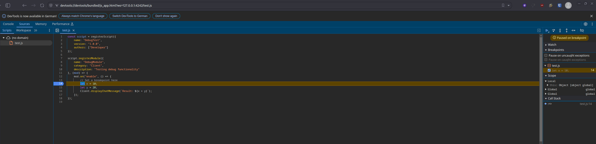

## Script Debugging

The Script API add-on can start a script with a debugger attached, using either the Chrome DevTools Protocol (Inspect) or the Debug Adapter Protocol (DAP).

## Debug Command

```
.script debug <name> [protocol] [suspendOnStart] [inspectInternals] [port]
```

Parameters:
- `name`: Script file to debug. If it is already loaded, it is unloaded first and loaded again with the debugger.
- `protocol`: `INSPECT` (Chrome DevTools, default) or `DAP`
- `suspendOnStart`: Pause execution when debugging begins (default `false`)
- `inspectInternals`: Allow inspection of internal engine state (default `false`)
- `port`: Debug server port number (default `4242` for Inspect, `4711` for DAP)

## Using Chrome DevTools

1. Start debugging:
```
.script debug myscript.js INSPECT true false 9229
```

2. LiquidBounce shows a DevTools URL in chat. Click it to copy it and open it in a Chromium-based browser:
```
devtools://devtools/bundled/js_app.html?ws=127.0.0.1:9229/myscript.js
```



## Using Debug Adapter Protocol (DAP)

For IDE integration (like VS Code):

1. Start debugging:
```
.script debug myscript.js DAP true false 4711
```

2. Configure your IDE to attach to localhost on that port.

## Troubleshooting

- "Debug port already in use": Choose a different port.
- Connection failed: Check that the port is free and not blocked by a firewall.
- Breakpoints not working: Check with `.script list` that the script loaded, and `.script errors <name>` for errors.

---
*Last updated: 2026-11-11, based on [source code](https://github.com/CCBlueX/LiquidBounce-Addon-ScriptAPI/blob/143f553/src/main/kotlin/net/ccbluex/liquidbounce/script/command/CommandScript.kt)*
