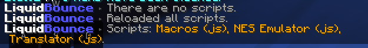
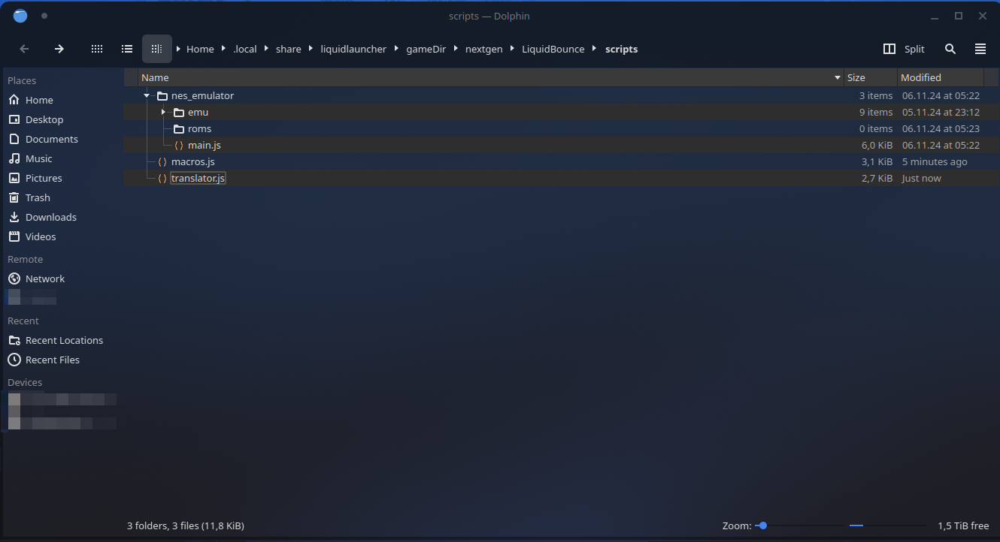
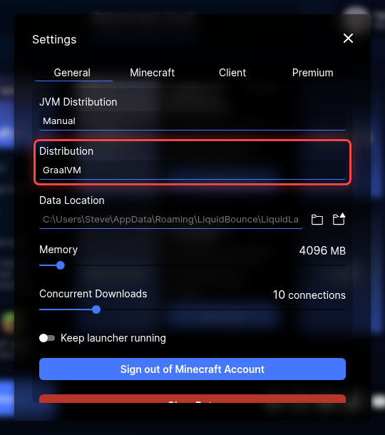

## Scripts
The Script API lets people from our community add features to LiquidBounce with JavaScript scripts, from simple [macros](https://forum.liquidbounce.net/topic/8354/script-macros) to an [NES Emulator](https://forum.liquidbounce.net/topic/8352/script-nes-emulator).

### Installing the Script API
Scripts need the [Script API add-on](https://github.com/CCBlueX/LiquidBounce-Addon-ScriptAPI). Without it, neither scripts nor the `.script` command are available.

1. Install it from the Marketplace with `.marketplace subscribe 771`, see [Add-ons](/docs/add-on-api/using-add-ons)
   - Or download `liquidbounce-scriptapi-*.jar` from the add-on's [releases](https://github.com/CCBlueX/LiquidBounce-Addon-ScriptAPI/releases) and install it like any other mod, either as an [additional mod in LiquidLauncher](/docs/get-started/liquidlauncher) or by placing it in the *mods* folder of a [manual installation](/docs/get-started/manual-installation)
2. Restart the game and check that `.addon list` shows `liquidbounce-scriptapi`

### Managing Scripts
The following commands are available to manage your scripts:

#### `.script list`
Shows a list of all installed scripts, and the ones that failed to load.

#### `.script browse`
Opens the scripts folder where all your scripts are stored.

#### `.script load <file>`
Loads a script. Replace `<file>` with the script's file name.

#### `.script unload <name>`
Unloads a script. Replace `<name>` with the script's name.

#### `.script reload`
Reloads all scripts. Use this command after adding new scripts to load them into the client.

#### `.script errors <name>`
Shows the errors a script ran into.

#### `.script edit <file>`
Opens a script in your default text editor.

#### `.script debug <file> [protocol] [suspendOnStart] [inspectInternals] [port]`
Loads a script with a debugger attached, see [Debugging](/docs/script-api/debugging).

### Installing Scripts
You can find scripts in our [community forum's script section](https://forum.liquidbounce.net/category/25/scripts). To install a script:

1. Type `.script browse` to open the scripts folder
2. Copy the script file into this folder. A script that comes as a zip file is extracted into its own folder, which needs a `main.js` (or `main.mjs`) file
3. Type `.script reload` to load the new script
4. Use `.script list` to check that the script was loaded

### Improving Script Performance

Scripts run considerably faster on GraalVM than on other Java runtimes. You have two options to use GraalVM:

1. Using LiquidLauncher (recommended)
   - Open LiquidLauncher settings
   - Set *JVM Distribution* to *Manual*
   - Select GraalVM as the *Distribution*
   
   

2. Manual GraalVM installation
   - Download GraalVM from [GraalVM's official website](https://www.graalvm.org/downloads/)
   - Install it and set it as the Java runtime in your Minecraft launcher
   - Launch LiquidBounce using the GraalVM installation

*Source: [A Simple Benchmark Performance Test for LiquidBounce's ScriptAPI](https://forum.liquidbounce.net/topic/8391/a-simple-benchmark-performance-test-for-liquidbounce-s-scriptapi)*

### Developing Scripts
To write your own scripts, see [Getting Started](/docs/script-api/getting-started).

---
*Last updated: 2026-11-11, based on [source code](https://github.com/CCBlueX/LiquidBounce-Addon-ScriptAPI/blob/143f553/src/main/kotlin/net/ccbluex/liquidbounce/script/command/CommandScript.kt)*
