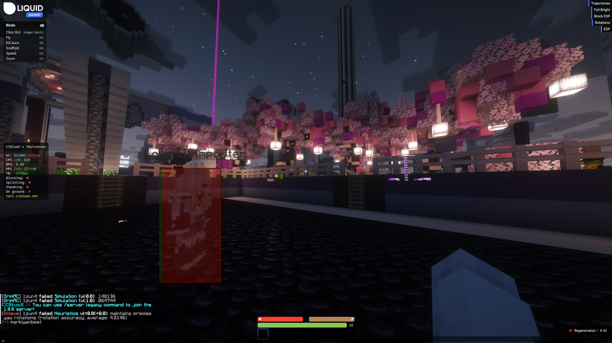
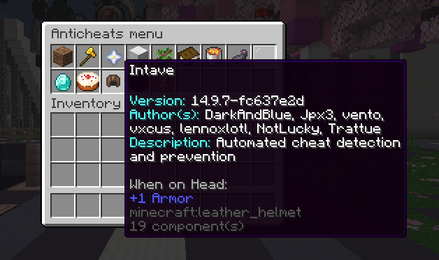
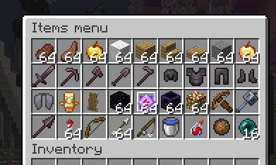

## CCBlueX's Anti-Cheat Test Server

The CCBlueX test server is a Minecraft server in Europe where you can try LiquidBounce against many different anti-cheats. Add **`test.ccbluex.net`** to your multiplayer server list.

### Connecting with or without a Minecraft account

You can join without a Minecraft account. The server then puts you in a sign-in lobby, where you sign in with your **LiquidBounce account**. Your name on the server comes from that account and starts with a star (`*`).

| Address | What happens |
|---|---|
| `test.ccbluex.net` | Detects whether your Minecraft session is online or offline. Offline sessions go to the sign-in lobby. If you joined with a premium Minecraft account and want to use your LiquidBounce account, type `/sign-in`. |
| `test-offline.ccbluex.net` | Treats every connection as offline and sends it through LiquidBounce account sign-in. |

After joining, use **`/server latest`** for the 26.3 server or **`/server legacy`** for the 1.8.8 server. You can join with any Minecraft version from 1.7.2 to 26.3. All servers share one chat. Each message starts with the server the sender is on, and on Minecraft 1.21.9 and newer you also see the sender's head.

If you play from Asia, join **`as.test.ccbluex.net`**. It has the same servers, closer to you.

### Selecting anti-cheats

Type **`/ac`** (or `/anticheat`) to open the anti-cheat menu, then click an anti-cheat to pick it. You can also type its name, like `/ac GrimAC`. To pick two, put a space between the names: `/ac GrimAC Vulcan`. Regular players can pick up to two at once. Press Tab while typing to see the names. The menu also shows each anti-cheat's version, author and description if it has them. The two servers don't have the same anti-cheats, and some combinations only work on one of them.

### Anti-cheats available

**Latest** is the 26.3 server (`/server latest`) and **Legacy** is the 1.8.8 server (`/server legacy`). The Server column shows where you can pick each anti-cheat. The practice server has the same anti-cheats as Latest. Open `/ac` after joining to see which ones are turned on right now.

| Anti-cheat | Server | Author(s) | Description |
|---|---|---|---|
| [Intave](https://intave.ac/) | Latest, Legacy | DarkAndBlue, Jpx3, vento, vxcus, lennoxlotl, NotLucky, Trattue | Automated cheat detection and prevention. |
| [GrimAC](https://github.com/GrimAnticheat/Grim) | Latest, Legacy | GrimAC | Simulation based movement checks. |
| [Matrix](https://matrix.rip/) | Latest, Legacy | RE, MIYU | |
| [NoCheatPlus](https://dev.bukkit.org/projects/nocheatplus) | Legacy | NeatMonster and contributors | Checks Minecraft exploits and invalid behavior. |
| [OldNoCheatPlus](https://dev.bukkit.org/projects/nocheatplus) | Legacy | NeatMonster and contributors | Older NoCheatPlus build. |
| [Spartan](https://spartan.top/) | Latest, Legacy | Evangelos Dedes (Vagdedes), pawsashatoy | |
| [AAC5](https://www.spigotmc.org/resources/6442/) | Legacy | konsolas | |
| AGC | Legacy | | |
| AIAC3 | Latest, Legacy | huzpsb | |
| [AntiCheatAddition](https://github.com/Photon-GitHub/AntiCheatAddition) | Latest, Legacy | Photon | Extra checks for cheats other anti-cheats may miss. |
| Axiom | Legacy | dw1e | Private anti-cheat. |
| CoffeeProtect | Latest, Legacy | Nik | |
| FairFight | Legacy | dw1e | Lightweight anti-cheat for 1.8 arenas. |
| [FairPlay](https://builtbybit.com/resources/fairplay-combat-anticheat-local-ai.111265/) | Latest, Legacy | ArkFlame | Anti-cheat with a neural network. |
| Frequency | Legacy | Elevated, Gson | |
| Gurei | Latest, Legacy | Gurei | Machine learning anti-cheat. |
| [Hawk](https://github.com/HawkAnticheat/Hawk) | Legacy | Islandscout | |
| [Horizon](https://www.spigotmc.org/resources/65830/) | Legacy | MrCraftGoo, Anthony M., Cipher and other contributors | |
| MX | Latest, Legacy | pawsashatoy, Vagdedes and other contributors | Combat and automation analysis. |
| [Reflex](https://g.reflex.rip/spigot) | Legacy | DarksideCode, sinnlosername | |
| [TakaAntiCheat](https://www.spigotmc.org/resources/45167/) | Legacy | dani02 | |
| Themis | Latest | Olexorus | |
| Verus | Legacy | | |
| [Vulcan](https://vulcanac.net/wiki) | Latest, Legacy | frep, GladUrBad, Joshb_, Elevated, retrooper | |

### Commands

| Command | What it does |
|---|---|
| `/menu` | Opens the main server menu. |
| `/ac [name ...]` | Opens the anti-cheat menu or selects one or more anti-cheats by name. |
| `/items` or `/i` | Opens the item menu for test gear. |
| `/give <item> [amount]` | Gives yourself an item. Some items are restricted. |
| `/enchant` | Opens the enchantment menu for an item. |
| `/effect <effect> [seconds] [amplifier]` | Applies a potion effect, subject to server restrictions. |
| `/repair` | Repairs repairable items in your inventory and armor slots. |
| `/heal` | Restores health and food. |
| `/health <amount>`; `/hunger <amount>` | Sets your own health or hunger. |
| `/damage [amount]` | Damages you to test reactions to damage and knockback. |
| `/damagetick <0-20>` | Changes your invulnerability ticks after taking damage. |
| `/scale [0.5-1.5]` | Changes your player size on the latest server. Without a value it goes back to `1`. |
| `/kill` | Kills your character for respawn testing. |
| `/clear` | Empties your inventory. |
| `/filtersystem` or `/fs` | Opens the event and packet filter menu. |
| `/exploit` | Opens the server's exploit test menu. `/exploit list` shows the available tests; execution asks for confirmation. |
| `/warp` or `/warp <name>` | Opens the warp menu or teleports to a named warp. |
| `/spawn`; `/back` | Goes to spawn or returns to your last death location. |
| `/tpa <player>`; `/tpahere <player>` | Requests a teleport to a player or asks them to teleport to you. |
| `/tpaccept`; `/tpdeny`; `/tpacancel` | Responds to or cancels a teleport request. |
| `/settings`; `/language [language]` | Opens server settings or changes your language. |
| `/ping`; `/gameprotocol` | Shows your ping or protocol version. |
| `/client` | Shows client information. |
| `/msg <player> <message>`; `/reply <message>` | Sends a private message to a player on any of the servers, or replies to one. |
| `/discord` | Shows the server's Discord link. |
| `/help [page]` | Shows the commands available to you on that server. |
| `/practice` | On Latest and Legacy, takes you to the practice server. On the practice server, opens the kits so you can queue for a duel. |
| `/botduel <kit> [beginner\|easy\|normal\|hard\|adaptive]` | On the practice server, duels a bot with a practice kit. The **Play** item does the same. |

You can use every command above on Latest and Legacy, except `/botduel`. The practice server has no test tools. There you can use `/menu`, `/ac`, `/settings`, `/language`, `/ping`, `/gameprotocol`, `/client`, `/msg`, `/reply`, `/ignore`, `/discord`, `/help`, `/spawn`, `/practice` and the duel commands.

All commands on this page that start with `/` are **server commands**, not LiquidBounce commands.

### Test bots

The bots around spawn look like real players to your client and to every anti-cheat. Standing and walking bots never die and never get knocked back, so you can hit them as often as you like to test reach, aim and hitboxes. Some show your reach above the hotbar or tell you how much damage you did. Others hit back with a knockback stick so you can test Velocity. Fighter bots attack you with crits, sprint resets and strafing.

### Practice server

Type **`/practice`** to go to the practice server. Your hotbar there has these items:

- **Play** (iron sword): Bed Wars and Sky Wars with bots, and duels against a bot in any kit.
- **Pick a map or opponent** (map): challenge a player, pick a Bed Wars or Sky Wars map, or queue for a duel with a kit.
- **Anticheats**, **Settings** and **Language**.
- **Leave the server** (red bed): back to the latest server.

### Bot duels

Open **Play**, pick a kit, then pick how hard the bot fights: beginner, easy, normal or hard. **Adaptive** starts easy, gets harder every time you win and easier every time you lose. You can also type **`/botduel <kit> [difficulty]`**. The bot has the same kit as you. Type `/leave` to give up.

Kits: sword, axe, mace, spear, crystal, elytra, diamond_smp, sumo, boxing, pot, soup, classic, uhc, vanilla, spear_mace and cart. The mace bot launches itself with wind charges and smashes down on you, the diamond SMP bot traps you in cobwebs and walls you off, and the axe bot breaks your shield.

The **Bot personality** switch in the menu changes how the bot plays: aggressive, defensive, kiter, trader, trickster or none. Until you switch it, every duel gets a random one.

The **1.8 Combat** switch turns the sword, pot, soup, classic, uhc, sumo and boxing kits into 1.8 kits: sword blocking, no attack cooldown, and 1.8 damage, knockback and regeneration. It works for queues, duels against players and bot duels. Against a bot you can also type `/botduel <kit>_nocd`, for example `/botduel sword_nocd`.

There are also five minigame kits. You can play them in queues, against players and against bots:

- **floor_is_lava**: the arena fills with lava one layer every 15 seconds, so build up.
- **pillar_of_fortune**: you stand on bedrock pillars over the void and get a random item every 5 seconds.
- **spleef**: dig the snow out from under your opponent.
- **tnt_run**: the floor falls away under your feet.
- **tnt_tag**: hit someone to pass on the TNT before it explodes after 30 seconds.

After a duel, `/duelrematch` challenges the same opponent again, and `/duelrequeue` turns automatic requeueing on or off.

### Bed Wars and Sky Wars

Open **Play** and pick **Bed Wars**, **Sky Wars** or **Sky Wars Teams** to join a game right away. To pick the map yourself or play with friends, use **Pick a map or opponent**, then **Pick a map**. Both games use 1.8 combat.

As soon as you wait in a game, bots fill it up to one place short of full, so one more player can always join. The bots have names like real players and play a little differently every game: some rush beds or hunt players, some collect diamonds and emeralds, some stay home and defend. The text under a bot's name shows what it is doing.

- In Bed Wars, bots bridge, buy gear and team upgrades, cover their bed with blocks, put spare items into the team chest and tell their team in chat what they are doing.
- In Sky Wars, bots loot their island and the middle, leave you the first pick of a chest you opened, and shoot or throw at you while you cross a bridge.

Bed Wars maps: Airshow, Amazon, Darkened, Speedway and Waterfall for eight teams of two, and Quartet for four teams of two. Sky Wars maps: Aquarius, Elven, Frostbite, Ring, Sanctum and Tiki, and team versions of all of them except Ring.

### Automated tests

Developers can let automated tests of their client or add-on play on the test server, with an anti-cheat of their choice watching. See [Testing](/docs/add-on-api/developers/testing).
