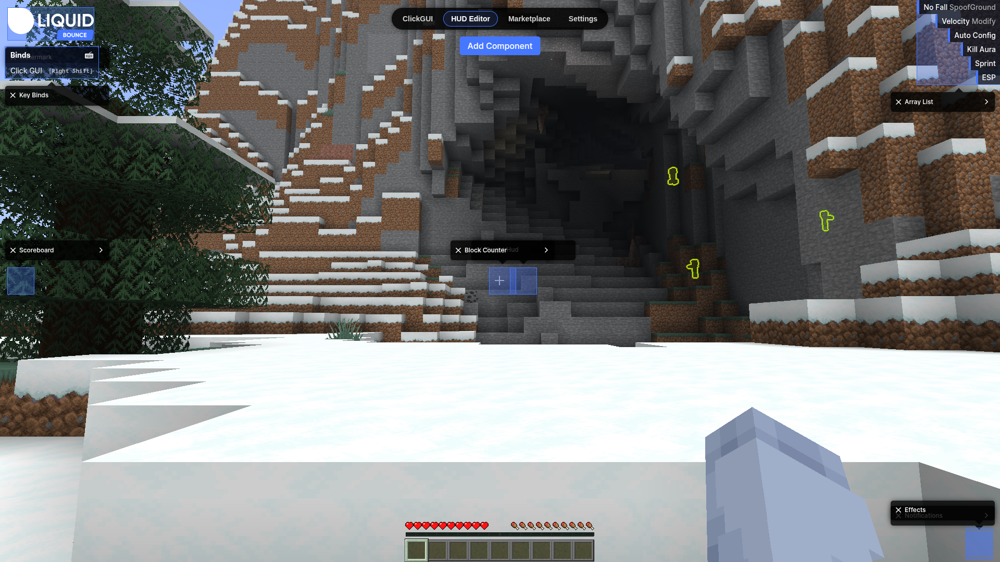
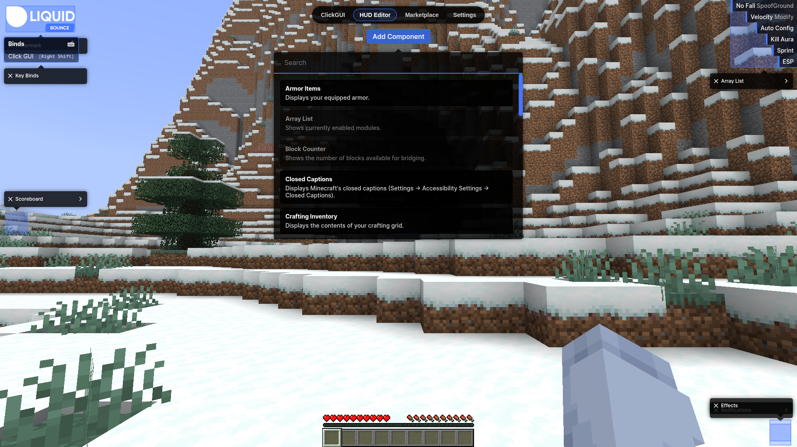
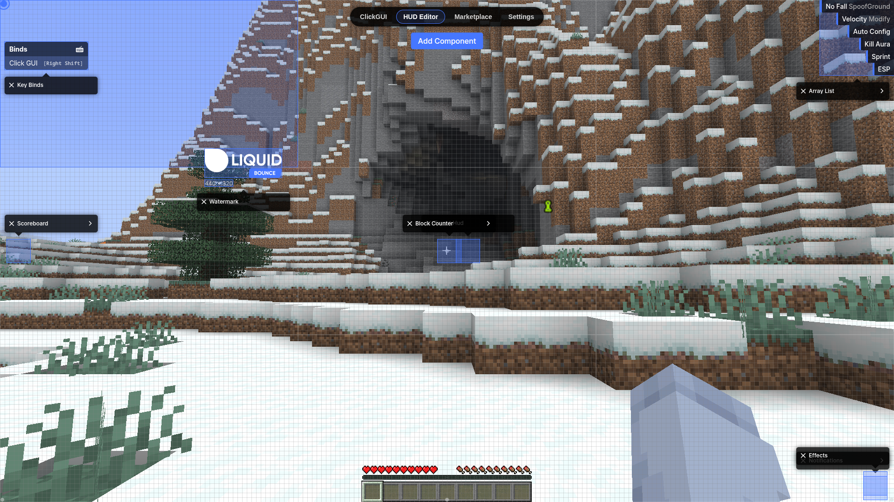
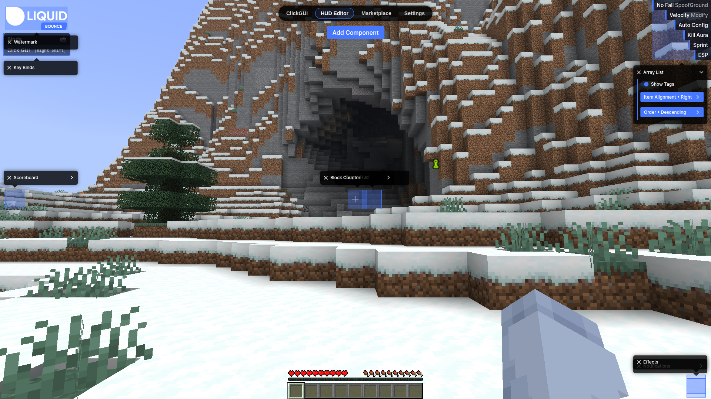
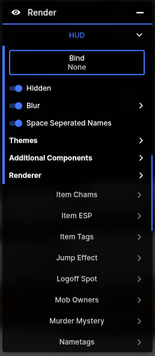
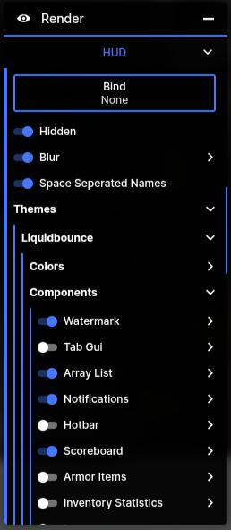
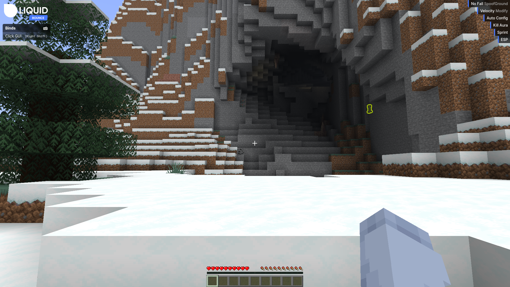
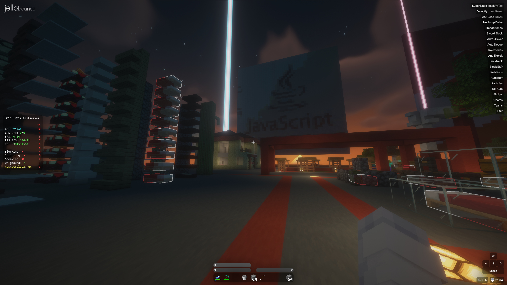
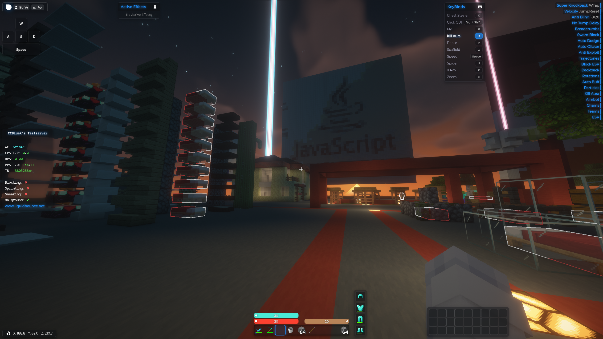

## HUD Customization

The HUD is made of components, small boxes that show information on your screen. You choose which ones you see and where they sit.

### Edit your HUD with the HUD Editor

1. Press **RIGHT SHIFT** to open the ClickGUI
2. Click the **HUD Editor** tab at the top of the screen

Next time, the ClickGUI opens on the tab you used last. While the HUD Editor is open, you can change every component.

#### Adding components

Click **Add Component** at the top of the screen. A list opens with the components of your theme and of your installed [add-ons](/docs/add-on-api/using-add-ons), each with a short description. Type in the search bar to find one, then click it to put it on your HUD. Most components can only be added once. Some, like **Text** and **Image**, can be added as often as you like.

#### Moving components

Drag a component to move it. While you drag, a grid appears and the screen is split into nine areas. The component sticks to the area you drop it in, so it stays in the same spot even if you change the window size or GUI scale. It also snaps to the grid and lines up with components next to it.

#### Changing and removing components

Each component shows its settings right next to it. To remove a component, click the cross next to its name.

### Configure your HUD Components in the module settings

You can also turn components on and off in the settings of the HUD module:

1. Press **RIGHT SHIFT** to open the ClickGUI
2. Go to **Render** → **HUD**

3. Click **Themes** → the name of your theme (for example LiquidBounce) → **Components**

### Use a different HUD look

Your [theme](/docs/theme-system/overview) decides which components there are and how they look. To change that, pick another theme from the [Marketplace](/docs/theme-system/overview#installing-themes-from-marketplace) or [make your own](/docs/theme-system/overview#creating-your-own-theme).

LiquidBounce theme:

JelloBounce theme:

BeautifyV2 theme:

---

*Last updated: 2026-11-11, based on [source code](https://github.com/CCBlueX/LiquidBounce/blob/d0486b17c/src-theme/src/routes/clickgui/tabs/hud_editor/HudEditor.svelte)*
