## Theme System
A theme decides how LiquidBounce looks: the HUD, the ClickGUI, the main menu and the other menus of the client. You can switch to another theme at any time.

<div class="fluid-width-video-wrapper" style="padding-top: 50%;">
    <iframe width="560" height="315" src="https://www.youtube.com/embed/hUZBVYX9jTM" title="YouTube video player" frameborder="0" allow="accelerometer; autoplay; clipboard-write; encrypted-media; gyroscope; picture-in-picture; web-share" referrerpolicy="strict-origin-when-cross-origin" allowfullscreen></iframe>
</div>

### LiquidBounce Theme
LiquidBounce comes with its own theme:

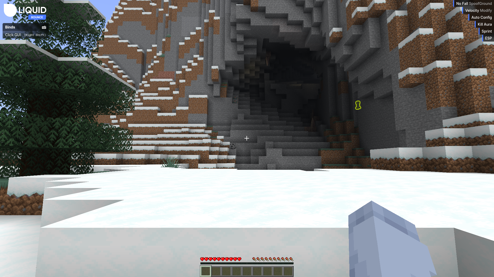
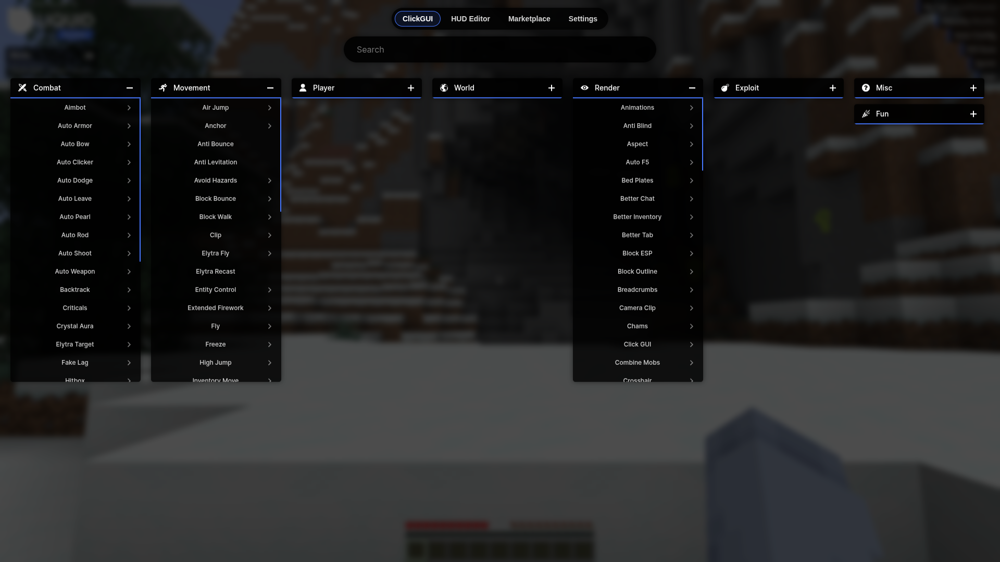
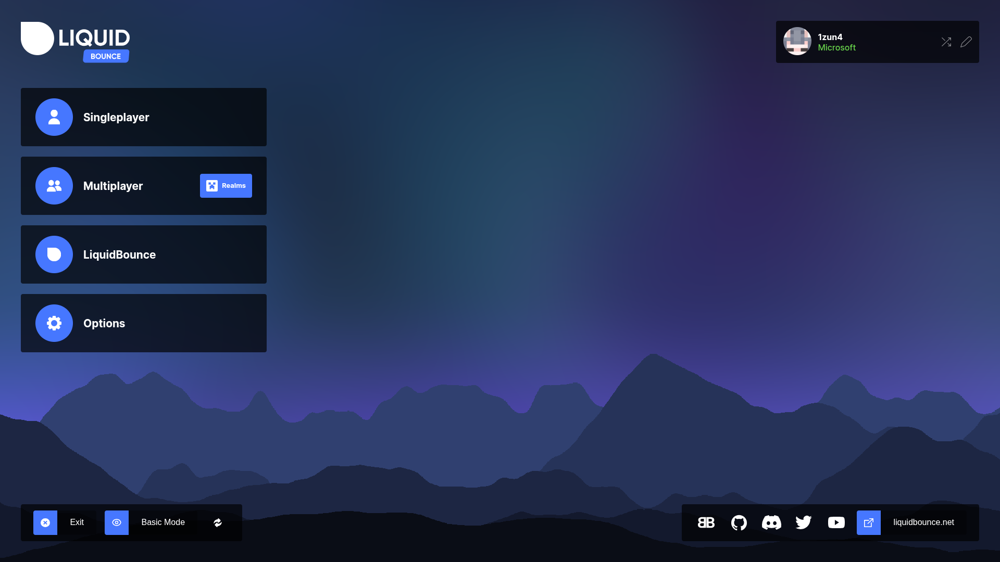

To make a theme yourself, see [Creating Your Own Theme](#creating-your-own-theme) below.

### Installing Themes from Marketplace

1. **See which themes there are**: `.marketplace list theme`

2. **Install one**: click the theme in the list, or type `.marketplace subscribe <id>`. The theme is downloaded for you.

3. **Use it**: type `.client theme` to see your installed themes, then click the new one. That runs `.client theme set <id>`.

> Only install themes from people you trust. A theme can connect to other servers on the internet, so a bad theme could take control of your client or steal your information. The Marketplace is the safest place to get themes.

### Themes

#### JelloBounce Theme
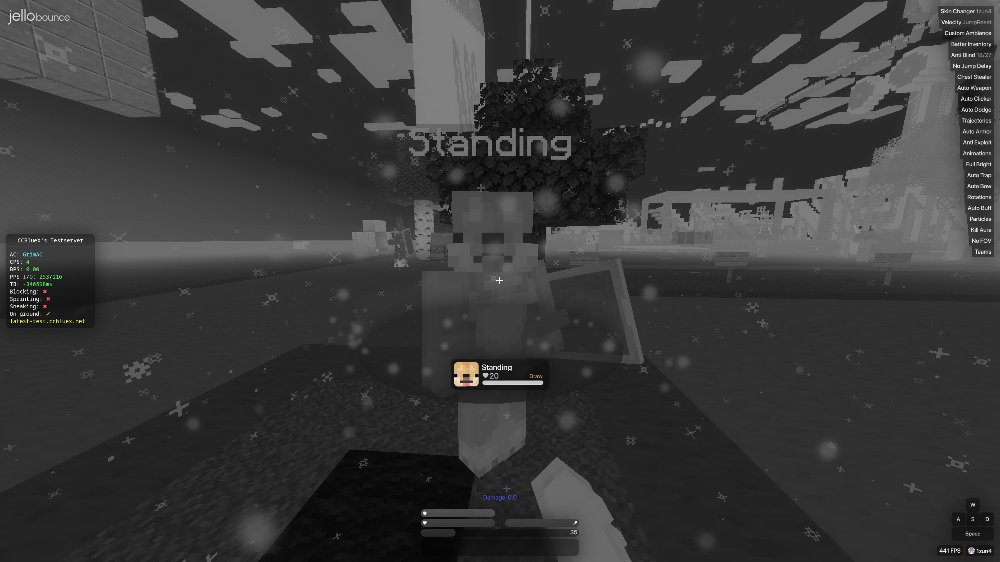
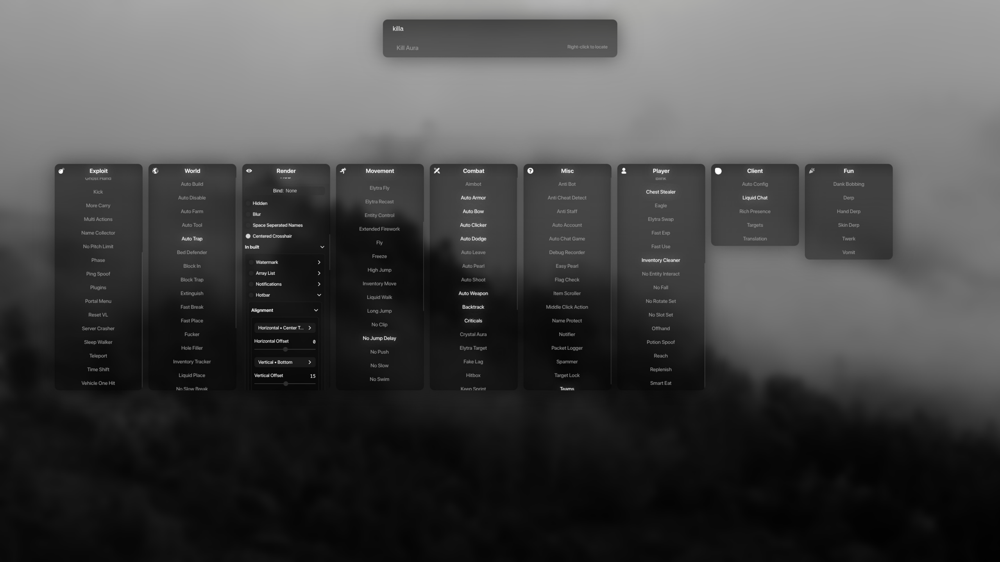
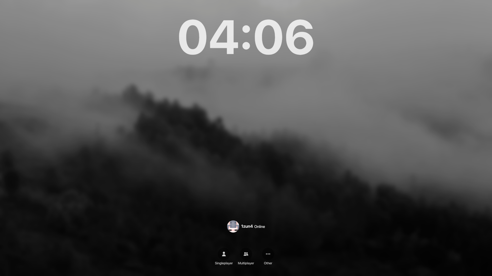

Install with: `.marketplace subscribe 265`  
[Repository](https://github.com/CCBlueX/LiquidBounce-Theme-JelloBounce)

#### BeautifyV2 Theme
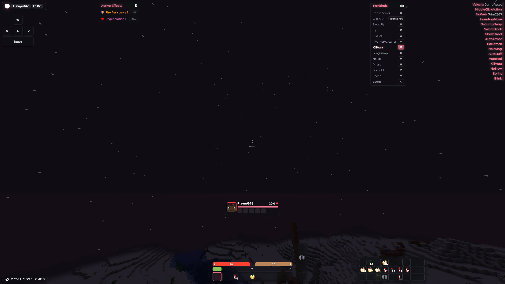
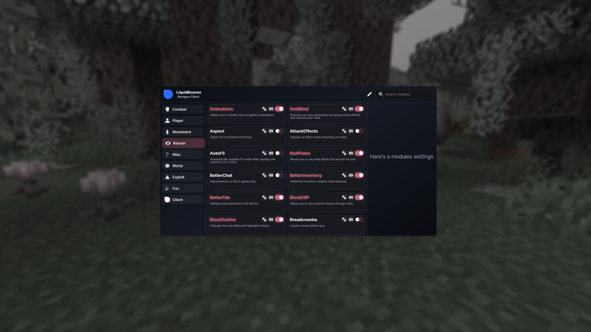

Install with: `.marketplace subscribe 581`  
[Repository](https://github.com/CCBlueX/LiquidBounce-Theme-BeautifyV2)

#### Wurst Theme
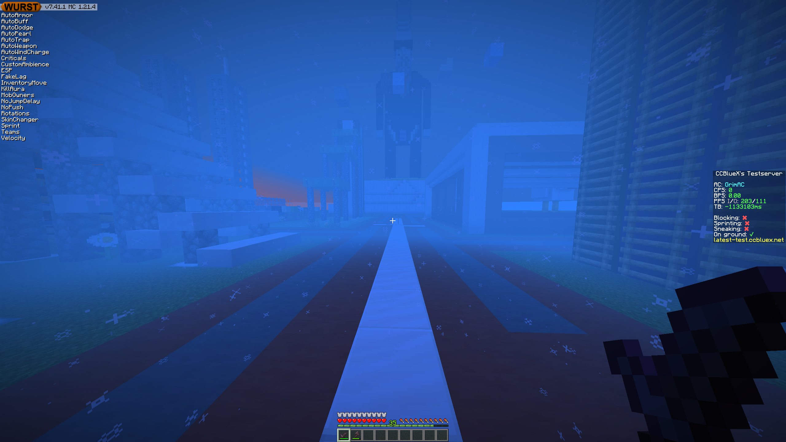
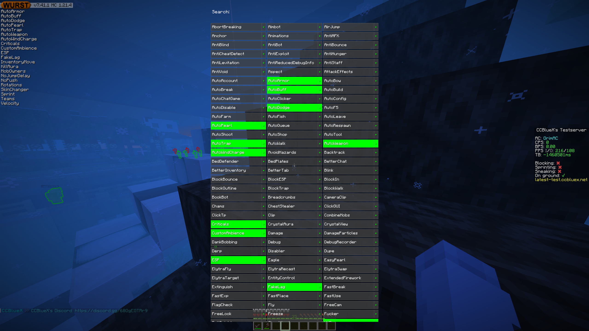
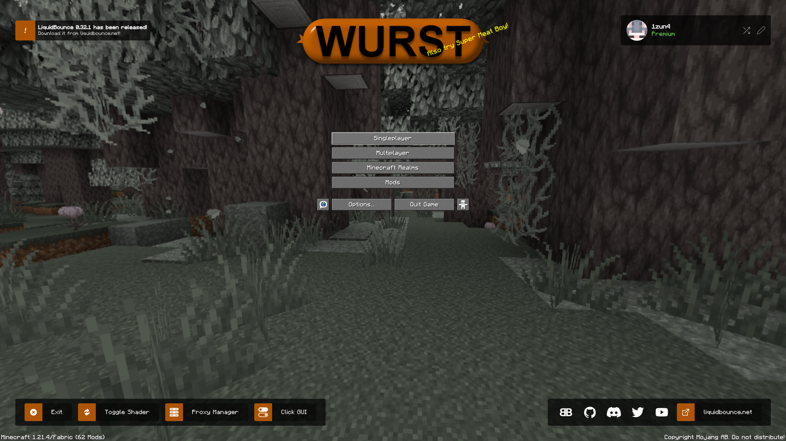

Install with: `.marketplace subscribe 561`  
[Repository](https://github.com/CCBlueX/LiquidBounce-Theme-Wurst)

### Creating Your Own Theme

Themes are web pages built with [Svelte](https://svelte.dev/). Start from the default theme and change it. You need Node.js.

1. **Fork or clone the default theme**:
   ```bash
   git clone https://github.com/CCBlueX/LiquidBounce-Theme
   cd LiquidBounce-Theme
   ```

2. **Edit the metadata file** (`public/metadata.json`) and give the theme its own `id`, `name`, `version` and `authors`:
   ```json
   {
     "id": "your-custom-id",
     "name": "YourTheme",
     "version": "0.1.0",
     "authors": ["YourName"]
   }
   ```
   The default theme uses:
   ```json
   {
     "id": "liquidbounce",
     "name": "LiquidBounce",
     "version": "0.1.0",
     "authors": ["CCBlueX"]
   }
   ```
   Three fields are optional:
   - `nativeFont` names one of the theme's loaded font faces, for example `"nativeFont": "Inter Medium"`. The client draws its own text with it. Without it, the client uses the font of the LiquidBounce theme, or a system font if that is missing.
   - `sounds` lists sounds the theme ships as `public/sounds/<name>.ogg`, for example `"sounds": ["click"]`. Names must be valid Minecraft identifier paths without `/`. See [Playing sounds](#playing-sounds).
   - `splash` gives the theme its own loading screen, a [Lottie](https://airbnb.io/lottie/) animation with background, text and accent colors. See [Splash Screen](/docs/theme-system/splash-screen).

3. **Start LiquidBounce, then install the dependencies and start the development server**:
   ```bash
   npm install
   npm run dev
   ```

4. **Load it in LiquidBounce**: type `.client theme set http://localhost:5173/` in the chat (use the address the development server prints). The theme reloads as you make changes.

5. **Install the finished theme**: run `npm run build`, open the themes folder with `.client theme browse`, copy the `dist` folder into it and rename it. Then use `.client theme set <id>`. `.client theme reload` picks up changes to installed themes.

6. **Publish to the Marketplace**: create the theme on the [Resources](https://liquidbounce.net/account/resources) page of your account and generate an API token there, as for [add-ons](/docs/add-on-api/developers/publishing#creating-the-add-on). The template's `.github/workflows/build.yml` has the upload steps commented out: set `MARKETPLACE_ITEM_ID` and `ZIP_NAME`, add `API_TOKEN` as a repository secret, and uncomment them.

### Playing sounds

The client registers each sound listed under `sounds` as `liquidbounce:theme/<theme id>/<name>`. To play it, or any other sound the game knows, send a `POST` request to `/api/v1/client/sound`:

```json
{"sound": "liquidbounce:theme/your-custom-id/click", "volume": 1.0, "pitch": 1.0}
```

`volume` and `pitch` are optional and default to `1.0`. Sounds play in the game's UI category, so the volume sliders apply to them.

### Handling Esc

Pressing **Esc** closes the whole theme screen. While a page has a dialog, dropdown or search open, it can keep the key for itself by sending a `PUT` request to `/api/v1/client/screen/escape`:

```json
{"name": "multiplayer", "keep": true}
```

Send `"keep": false` once the layer is closed. `name` must be the theme screen that is open right now, otherwise the client answers with `403`. Every screen change gives Esc back to the client, so a page that still has a layer open has to ask again. The LiquidBounce theme does this, so Esc first closes its dialogs, dropdowns and searches.

---

*Last updated: 2026-11-11, based on [source code](https://github.com/CCBlueX/LiquidBounce/blob/d0486b17c/src/main/kotlin/net/ccbluex/liquidbounce/integration/theme/ThemeMetadata.kt)*
