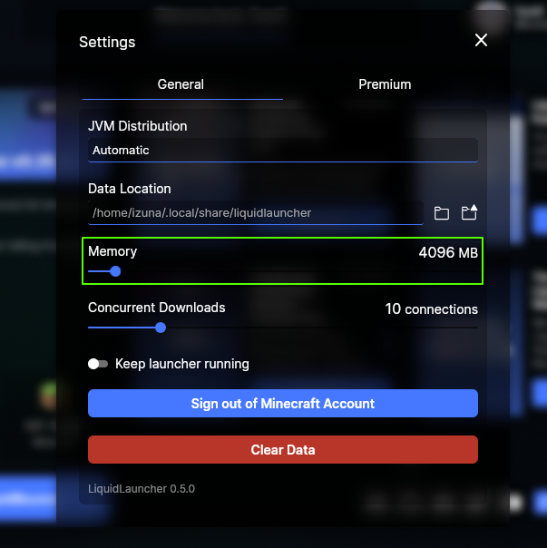
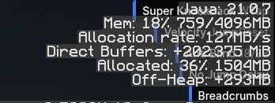
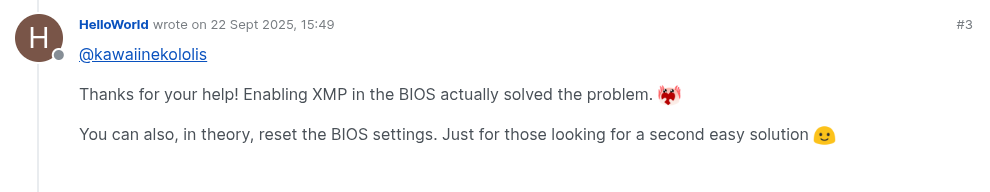

# Troubleshooting FPS Drops & Freezing

Does your game lag or freeze with LiquidBounce, while playing or when you open the HUD, ClickGUI or a menu? Work through these steps in order. Most people only need the first few.

## Table of Contents

1. [Check RAM Allocation](#1-check-ram-allocation)
2. [Check RAM Speed (Critical)](#2-check-ram-speed-critical)
3. [Verify GPU is Being Used](#3-verify-gpu-is-being-used)
4. [Update GPU Drivers (Critical)](#4-update-gpu-drivers)
5. [Remove Conflicting Mods](#5-remove-conflicting-mods)
6. [Enable Accelerated Paint (Critical)](#6-enable-accelerated-paint)
7. [Optimize HUD and Theme Settings](#7-optimize-hud-and-theme-settings)
8. [Limit GUI Renderer FPS](#8-limit-gui-renderer-fps)
9. [Reduce Rendering Quality (Last Resort)](#9-reduce-rendering-quality-last-resort)

---

## 1. Check RAM Allocation

The game needs enough memory (RAM). Too little is one of the most common reasons for lag.

#### Using LiquidLauncher

LiquidLauncher gives the game 4 GiB by default, which is enough for most people. To check it:

1. Open LiquidLauncher
2. Go to **Settings** or **Launch Options**
3. Check the RAM allocation (it should be at least 4 GiB)
4. Change it if needed



#### Using Minecraft Launcher

The official Minecraft Launcher often gives the game only 2 GiB, which may not be enough:

1. Open Minecraft Launcher
2. Go to the **Installations** tab
3. Hover over your installation, click the **three dots**, then **Edit**
4. Click **More Options**
5. Find the **JVM Arguments** field
6. Look for `-Xmx2G` (this means 2 GiB at most)
7. Change it to `-Xmx4G` (or `-Xmx6G` if your computer has 16 GB of RAM or more)
8. Make `-Xms` the same, for example `-Xms4G -Xmx4G`
9. Save and launch

For more help, see this [tutorial on allocating RAM to Minecraft](https://www.minecraftforum.net/forums/support/java-edition-support/3001598-tutorial-how-to-allocate-more-ram-to-minecraft).

#### Check System Environment Variables

Some settings on your computer can override what the launcher says. Check them too:

**Windows:**
1. Press `Win + R`, type `sysdm.cpl`, and press Enter
2. Go to the **Advanced** tab, then **Environment Variables**
3. Look in both **User variables** and **System variables** for:
   - `_JAVA_OPTIONS`
   - `JAVA_TOOL_OPTIONS`
   - `JDK_JAVA_OPTIONS`
4. If one of them has a low `-Xmx` or `-Xms` value (like `-Xmx2G`), either:
   - delete the variable, or
   - raise the values to at least `-Xms4G -Xmx4G`
5. Click **OK** and restart your computer

**Linux/macOS:**
1. Open your shell configuration file (`~/.bashrc`, `~/.zshrc`, or `~/.profile`)
2. Look for lines like:
   ```bash
   export _JAVA_OPTIONS="-Xmx2G"
   export JAVA_TOOL_OPTIONS="-Xmx2G"
   ```
3. Delete these lines or raise the values to `-Xmx4G`
4. Reload your shell with `source ~/.bashrc` (or open a new terminal)

**Note:** 4 to 6 GiB is a good amount. Don't give the game more than half of your computer's total RAM.

#### Verify RAM Allocation In-Game

1. Launch Minecraft with LiquidBounce
2. Press **F3** to open the debug screen
3. Look at the memory line in the top right corner (for example "Mem: 25% 1024/4096MB")
4. The second number should match the RAM you set (4096MB = 4 GB)



## 2. Check RAM Speed (Critical)

LiquidBounce's menus are drawn by a small built-in web browser, and every picture it draws goes through your RAM before it reaches the graphics card. Slow RAM makes the game lag, even with a fast graphics card.

The [gl-bench](https://github.com/1zun4/gl-bench) tool tests whether your RAM is the slow part.

#### Enable XMP in BIOS

XMP (Extreme Memory Profile) lets your RAM run at the speed it was sold with. Without it, RAM often runs slower:

1. Restart your computer and open the BIOS (usually by pressing `Delete`, `F2`, or `F12` while it starts)
2. Find the XMP, DOCP or EOCP setting (where it is depends on your motherboard):
   - **ASUS/MSI/Gigabyte:** usually under "AI Tweaker", "OC", or "Advanced"
   - **AMD motherboards:** look for DOCP (Direct Overclock Profile)
3. Turn on XMP Profile 1 (or DOCP)
4. Save and exit the BIOS

This has fixed FPS drops for many players.



#### Check RAM Slot Configuration

Your RAM sticks should sit in the right slots:

1. Check your motherboard manual for which slots to use
2. With 2 sticks, this is usually slots 2 and 4 (or A2 and B2)
3. Reseat the sticks if needed

#### Alternative: Reset BIOS Settings

If you don't want to change BIOS settings yourself, you can reset them:

1. Open the BIOS
2. Find "Load Optimized Defaults" or "Reset to Default"
3. Save and exit

## 3. Verify GPU is Being Used

If your monitor cable is plugged into the motherboard instead of the graphics card, your computer uses the weaker built-in graphics.

#### Check Your Monitor Connection

1. Look at the back of your computer
2. Find where the monitor cable is plugged in:
   - **Right:** in the graphics card (usually lower on the case, in its own slot)
   - **Wrong:** in the motherboard (usually higher up, near the USB ports and audio jacks)
3. If it is in the motherboard, shut down your computer and move the cable to the graphics card

#### Verify in Windows

1. Open **Task Manager** (`Ctrl + Shift + Esc`)
2. Go to the **Performance** tab
3. Look for **GPU 0** and **GPU 1** (you see both if your computer has built-in graphics)
4. Launch Minecraft with LiquidBounce
5. Check which GPU is busy. It should be your graphics card (NVIDIA or AMD), not Intel built-in graphics

## 4. Update GPU Drivers

Old graphics drivers can cause lag and other problems.

**NVIDIA:**
1. Visit [NVIDIA Driver Downloads](https://www.nvidia.com/Download/index.aspx)
2. Select your GPU model and operating system
3. Download and install the latest Game Ready Driver

**AMD:**
1. Visit [AMD Driver Downloads](https://www.amd.com/en/support)
2. Select your GPU model
3. Download and install the latest Adrenalin driver

**Intel:**
1. Visit [Intel Driver & Support Assistant](https://www.intel.com/content/www/us/en/support/detect.html)
2. Use the auto-detect tool or pick your GPU yourself
3. Download and install the latest driver

## 5. Remove Conflicting Mods

Other mods can slow the game down or clash with LiquidBounce:

1. Make a backup of your mods folder
2. Remove every mod except LiquidBounce and the mods it needs
3. Check if the lag is still there
4. If it's gone, add your mods back one at a time to find the one causing it

## 6. Enable Accelerated Paint

Accelerated Paint lets your graphics card draw the menus directly, which can make them much faster. It is set to **Auto**, so it turns on by itself on computers where it is known to work.

To turn it on yourself:
1. Open the **ClickGUI** (_RSHIFT_)
2. Go to **Settings**, then **GuiRenderer**, then **AcceleratedPaint**
3. Set it to **On**

**Good to know:**
- It only works on Windows and Linux.
- **AMD graphics cards:** a [known bug](https://github.com/chromiumembedded/cef/issues/3968) can slowly fill up your video memory over a long session. Keep an eye on it.
- **Intel graphics:** not supported because of [driver problems](https://github.com/IGCIT/Intel-GPU-Community-Issue-Tracker-IGCIT/issues/1143).
- **Linux:** works on both Wayland and X11.

## 7. Optimize HUD and Theme Settings

#### Use Default Theme

Custom themes can be slower. To switch back to the default theme:

1. Open the chat
2. Type `.client theme set liquidbounce`
3. The default theme loads right away

Learn more on the [Theme System Overview](/docs/theme-system/overview) page.

#### Disable Unnecessary HUD Components

Every HUD element costs a little speed. Turn off the ones you don't use:

1. Go to **HUD**, then **Themes**, then your theme's name (for example LiquidBounce), then **Components**
2. Look through the elements that are turned on
3. Turn off the ones you don't need

See [HUD Customization](/docs/theme-system/hud-customization) for more.

## 8. Limit GUI Renderer FPS

With no limit, the menus can redraw as often as your screen allows. Setting a limit of 60 can help a lot:

**For HUD:**
1. Go to **HUD**, then **Renderer**, then **Fps**
2. Set it to `60`

**For ClickGUI:**
1. Go to **ClickGUI**, then **Renderer**, then **Fps**
2. Set it to `60`

## 9. Reduce Rendering Quality (Last Resort)

If nothing else helped, you can lower the quality of the menus. They will look blurry (at the lowest setting they draw at half resolution), but the game can run much faster:

1. Open the **ClickGUI** (_RSHIFT_)
2. Go to **Settings**, then **GuiRenderer**, then **Quality**
3. Lower the value (1 is full quality, 0.5 is the lowest)

Only do this if every other step failed.

## Still Having Issues?

[Contact our support team](https://ccbluex.net/contact) and send:

- Your computer's parts (CPU, GPU, RAM)
- Your Minecraft version and LiquidBounce build
- What you do when the problem happens
- Your latest.log file from the logs folder:
  - **LiquidLauncher (Windows):** `%APPDATA%/CCBlueX/LiquidLauncher/gameDir/nextgen/logs`
  - **LiquidLauncher (Linux):** `~/.local/share/liquidlauncher/gameDir/nextgen/logs`
  - **LiquidLauncher (macOS):** `~/Library/Application Support/liquidlauncher/gameDir/nextgen/logs`
  - **Minecraft Launcher:** `.minecraft/logs/`
- A video of the problem, if you can
