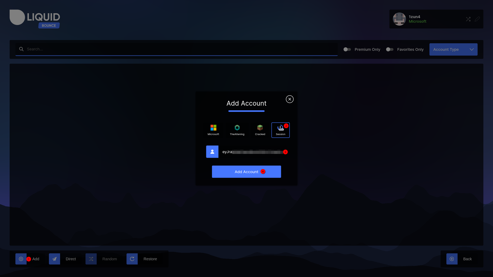
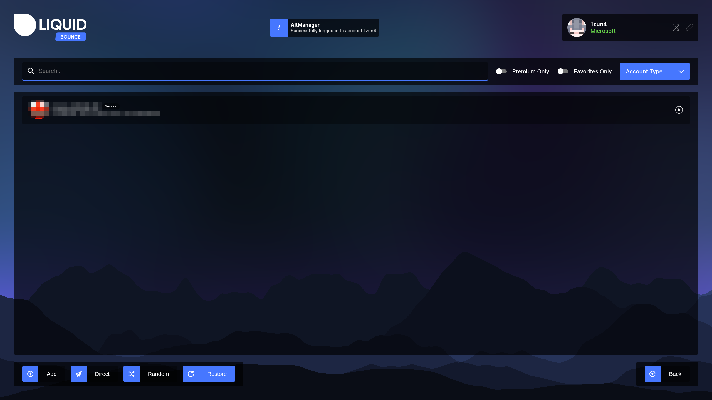
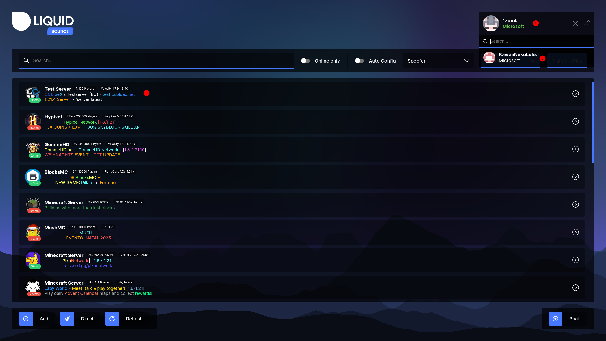

# Using the Account Manager

In the Account Manager you can:

- Log in with different kinds of accounts: [Microsoft](#microsoft-login), [TheAltening](#thealtening-login), [Cracked (offline)](#cracked-offline-login) and [Session / Access Token](#session-access-token-login).
- [Go back](#restoring-the-original-game-account) to the account you started the game with.
- [Switch quickly](#account-selector) between saved accounts.

## Opening the Account Manager

On the title screen, click the pen icon next to your name in the account box at the top right. A window opens with all your saved accounts and buttons to add, edit or remove them.

## Adding Accounts

Every saved account shows in the list, with an icon for its type. Click one to log in to it.

### Microsoft Login

Use this if you bought Minecraft with a Microsoft account. There are three ways to sign in:

- **WebView** opens a browser window inside the game.
- **Device Code** shows a link and a code. Open the link on any device and type in the code.
- **Credentials** signs in with the email address and password of your Microsoft account.

<video controls src="/images/get-started/account-manager/login-with-microsoft.mp4" style="max-width: 100%; border-radius: 8px;"></video>

1. In the Account Manager, click **Add Account** and choose **Microsoft**.
2. Pick a way to sign in and follow the steps.
3. Sign in to your Microsoft account and allow the permissions it asks for.
4. The account now shows in the list with your Minecraft name. Click it to log in.

The account box on the title screen now shows your Microsoft account.

> Microsoft sign-in only works in LiquidBounce *v0.40.0* or newer, because Mojang blocked the login of older versions. You can read about it in our blog post [Microsoft Tried to Ban Us!](https://liquidbounce.net/blog/article/WhKoUYc3). Update the client with [LiquidLauncher](/docs/get-started/liquidlauncher).

> If signing in with Microsoft or Session does not work, see
> [Fixing issues with the system's hosts file](/docs/troubleshooting/fixing-liquidlauncher#fixing-issues-with-the-systems-hosts-file).

### TheAltening Login

Use this if you have alt tokens from [thealtening.com](https://thealtening.com).

1. In the Account Manager, click **Add Account** → **TheAltening**.
2. Paste the token from TheAltening.
3. Save the account.
4. Click it in the list to log in.

Only use tokens from the real [thealtening.com](https://thealtening.com) website. Tokens from elsewhere are often broken or unsafe.

### Cracked (Offline) Login

A cracked account is just a name. It only works on servers that do not check accounts (online mode turned off). Most big servers do check, so cracked accounts cannot join them.

1. In the Account Manager, click **Add Account** → **Cracked** (sometimes called "Offline").
2. Type any name you like.
3. Save the account.
4. Click it in the list to switch to it.

### Session / Access Token Login

A session (or access token) lets you log in with a Minecraft token you already have, for example from another launcher.

1. In the Account Manager, click **Add Account** → **Session / Access Token**.
2. Paste your token into the token field.
3. Save the account and click it to log in.

Tokens stop working after a while, or when you log out somewhere else. Then you need a new one.

## Restoring the Original Game Account

To go back to the account you started the game with, open the Account Manager and click **Restore** (the refresh icon) in the bar at the bottom left.

## Account Selector

The Account Selector lets you switch accounts without opening the whole Account Manager.

On the title screen, click anywhere on the account box at the top right (but not on the arrow or pen icon). A small list of your favorite and recently used accounts opens.

<video controls src="/images/get-started/account-manager/changing-account.mp4" style="max-width: 100%; border-radius: 8px;"></video>

Each entry shows the Minecraft name with the account type below it ("Microsoft", "TheAltening", "Cracked" or "Session"). Click one to switch to it.

Use the Account Manager to add accounts or to sort through many of them, and the Account Selector for everyday switching.

## Random Cracked Name (Arrow Icon)

Click the arrow icon next to your name on the title screen. LiquidBounce makes up a random name and switches you to a cracked account with it. This is handy when you need a throwaway name fast.

## Switching Accounts After a Disconnect

When a server kicks you or you lose connection, the disconnect screen shows the same account box as the title screen. If you log in to another account there (with the Account Selector, the Account Manager or the arrow icon), LiquidBounce joins the server again with that account.

At the bottom left are a **Reconnect** button and an **Auto reconnect** switch. With **Auto reconnect** on, the button counts down and LiquidBounce joins the server again after 5 seconds. The countdown waits while your mouse is over the account box or while you are logging in. The switch stays the way you left it.
