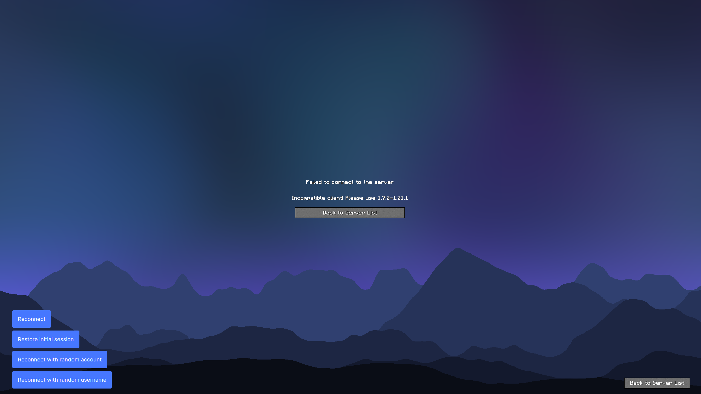
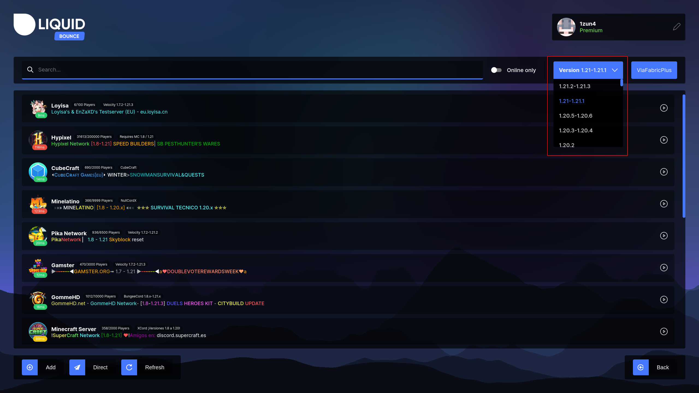
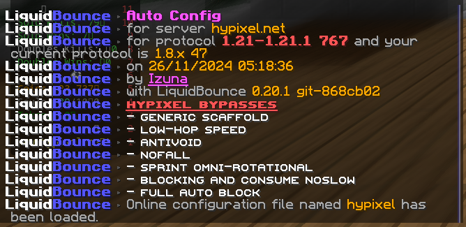

# How to Change Your Minecraft Version in LiquidBounce

Some servers only let you join with a certain Minecraft version. LiquidBounce can pretend to be an older (or other) version so you can still play there.

### The server has ViaVersion

Join with the newest Minecraft version. The server then knows you are on a new client, and its anti-cheat flags you less often.

### The server does not have ViaVersion

Use the version selector in the top right corner of the Multiplayer menu and pick the version the server needs.

This uses [ViaFabricPlus](https://modrinth.com/mod/viafabricplus), a mod that lets you join servers on almost any Minecraft version. It also changes things like movement, block hitboxes and rendering so they work like in the old version. It supports:

- Release: 1.0.0 to 1.21.11
- Beta: b1.0 to b1.8.1
- Alpha: a1.0.15 to a1.2.6
- Classic: c0.0.15 to c0.30 (including CPE)
- Bedrock: 1.21.124 (only some features work)
- Snapshots, April Fools versions and Combat Tests

### AutoConfig tells you to use another version

Pick that version in the version selector in the top right corner of the Multiplayer menu.
