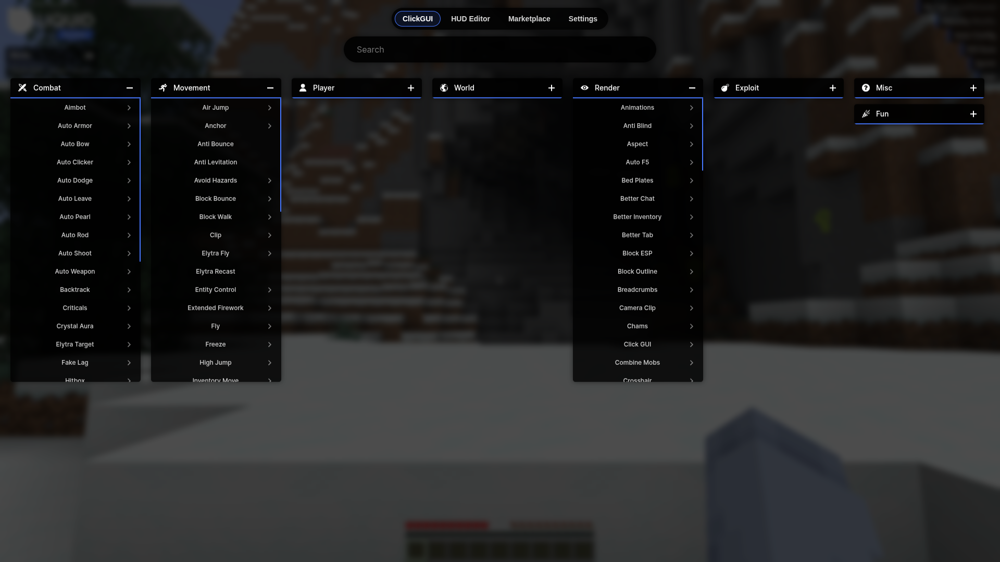
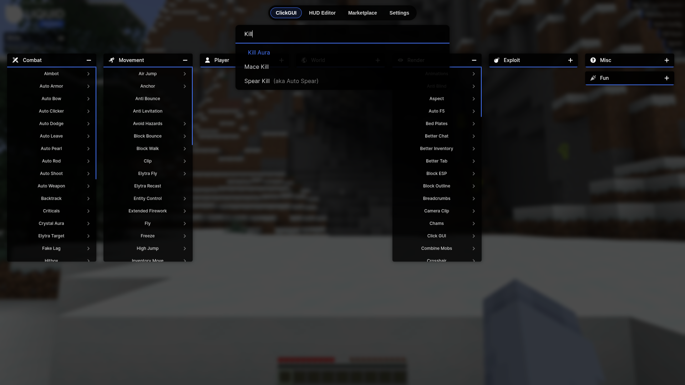
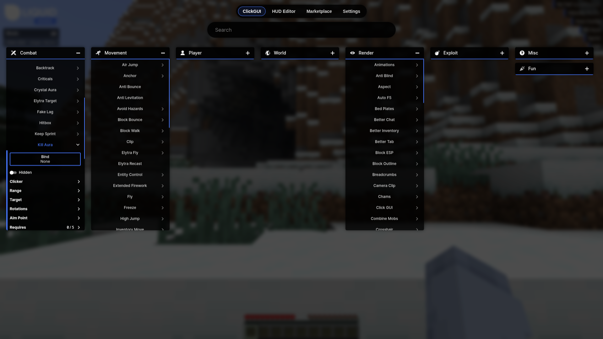

# Using the ClickGUI

The ClickGUI is where you turn modules on and off and change their settings. You can open it from the main menu and while you play.

## Opening the ClickGUI

- In a world: press **Right Shift** (you can change this key).
- On the title screen: click **LiquidBounce → ClickGUI**.

The game is blurred in the background and the ClickGUI panels show on top.

## Categories

Modules are sorted into categories. Each category is its own panel:

- **Combat**: fighting, for example KillAura.
- **Player**: things that help your player, for example ChestStealer or Eagle.
- **Movement**: moving faster or differently, for example Fly or Speed.
- **Render**: things you see, for example ESP.
- **World**: building, mining and farming, for example AutoFarm.
- **Misc**: modules that fit nowhere else.
- **Exploit**: tricks that use mistakes in how servers work.
- **Fun**: modules just for fun.

You can scroll inside a panel to see more modules, and drag a panel to move it.

## Searching for Modules

Type part of a module name in the search bar (for example `Kill Aura`). Then:

- Left-click a result, or pick it with the arrow keys and press **Enter**, to turn it on or off.
- Right-click a result to open its category panel with the module in view.

## Turning Modules On and Off

Left-click a module in its panel or in the search results. Modules that are on are highlighted.

## Module Settings

Most modules have settings, such as modes, ranges or a key. To open them, right-click the module in its panel (you can search for it and right-click the result to jump there).

In the settings you can:

- Change the **bind**, the key that turns the module on and off without opening the ClickGUI.
- Turn on **Hidden** so the module does not show in the Array List on your HUD.
- Move sliders, for example range, speed or delay.
- Turn other options on or off.

Right-click the module again to close its settings. Your changes are saved by themselves.

## Tabs

The bar at the top switches between tabs. The ClickGUI opens on the tab you used last.

- **ClickGUI**: the module panels described on this page.
- **HUD Editor**: move the parts of your HUD around, see [HUD Customization](/docs/theme-system/hud-customization).
- **Settings**: settings for the whole client, such as the language and the command prefix.

## Closing the ClickGUI

Press **Esc**.
