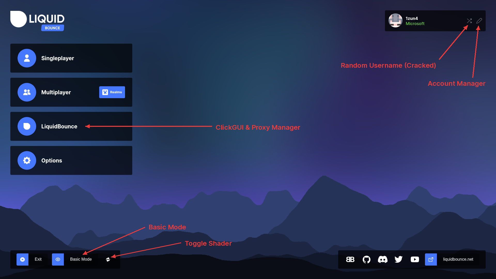

# Introduction

When you start the game with LiquidBounce, you see the LiquidBounce title screen.

## Where to go next

- [Using the Account Manager](/docs/usage/account-manager): add Microsoft, TheAltening, cracked and session accounts, switch between them, and go back to your own account.
- [Using the ClickGUI](/docs/usage/clickgui): turn modules on and off and change their settings, on the title screen or while you play.
- [Theme Overview](/docs/theme-system/overview) and [HUD Customization](/docs/theme-system/hud-customization): change how your HUD, main menu and ClickGUI look.
- [Using the Proxy Manager](/docs/usage/proxy-manager): join servers through a SOCKS5 or HTTP proxy (for example from [liquidproxy.net](https://liquidproxy.net)) so they see a different IP address.

## Title Screen

- On the left are **Singleplayer**, **Multiplayer**, **LiquidBounce** (Proxy Manager and ClickGUI) and **Options**.
- At the bottom left are **Exit**, **Basic Mode**, and **Toggle Shader**, which turns the moving background on or off.
- At the bottom right are links to the LiquidBounce website, Discord, GitHub, Twitter, YouTube and more.
- At the top right is the account you are playing on:
  - The pen icon opens the Account Manager.
  - The arrow icon gives you a random cracked name.
  - Clicking anywhere else on the box opens the Account Selector.

### Basic Mode

Basic Mode swaps the LiquidBounce menus for the normal Minecraft ones. You get a small row of buttons on the left edge: **Click GUI**, **Alt Manager**, **Proxy Manager** and **Full Mode**. Full Mode brings the LiquidBounce menus back.
