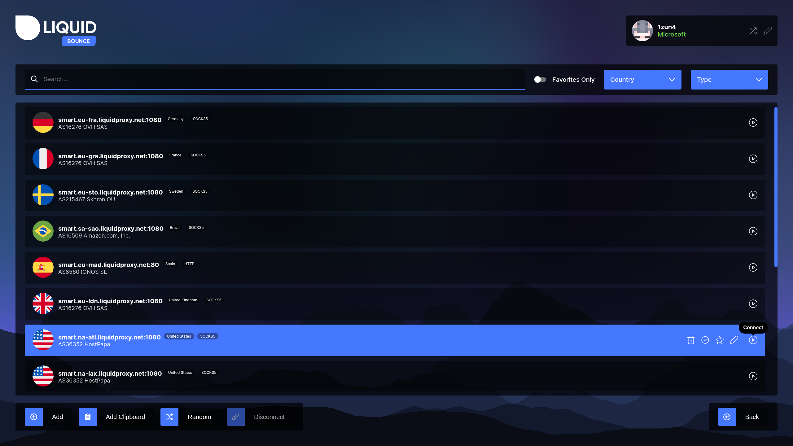
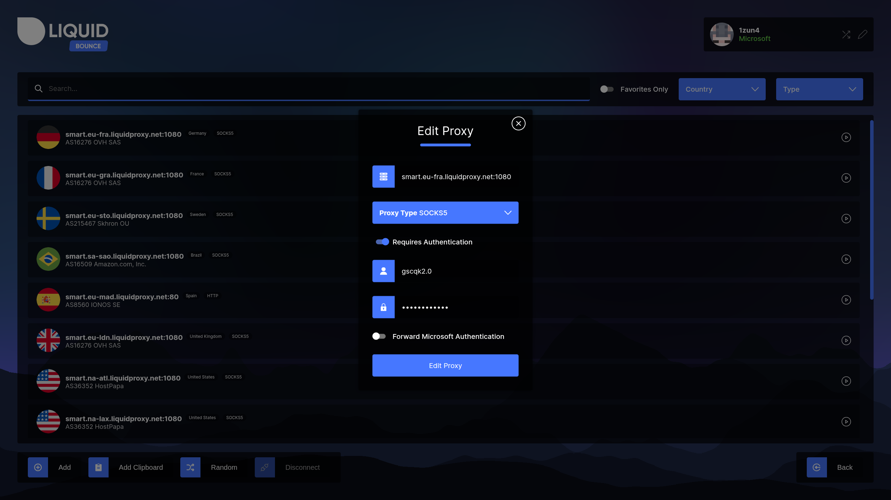

## Using the Proxy Manager

The Proxy Manager lets you join servers through a proxy, so the server sees a different IP address. This helps when a server has banned your IP or blocks VPNs with an AntiVPN plugin.

### Opening the Proxy Manager

1. On the title screen, click **LiquidBounce** on the left.
2. Pick **Proxy Manager**.

### Adding a Proxy

1. Click **Add Proxy**.
2. Fill in the proxy details:
   - **Host**: the proxy address (for example `proxy.example.com`).
   - **Port**: the proxy port (for example `1080`).
   - **Username** and **Password**: only if your proxy needs them.
3. Pick the proxy type: **SOCKS5** or **HTTP**.
4. If you want, turn on **Proxy Resource Packs** to download server resource packs through the proxy too, and **Proxy DNS** to let the proxy look up server addresses for you.
5. Click **Save**.

### Using a Proxy

Pick a proxy from the list. Every server you join from then on goes through it.

Servers on your own computer or home network (like a LAN world) do not use the proxy, so you can leave it selected.

To stop using the proxy, click **Disconnect** at the bottom left of the Proxy Manager.

### Using LiquidProxy

[LiquidProxy](https://liquidproxy.net) is our proxy service made for Minecraft. It has dedicated and residential proxies that help you get past AntiVPN plugins and IP bans.

If you have a LiquidProxy subscription, you can find your proxy details on [liquidproxy.net](https://liquidproxy.net). Then do one of these:

- Create a route address on the dashboard and add it to your Minecraft server list. You do not need the Proxy Manager for this.
- Copy your proxy details (host, port, username, password) and add them in the Proxy Manager as shown above.

For more about LiquidProxy, see the [LiquidProxy guide](/docs/liquidproxy/overview).
