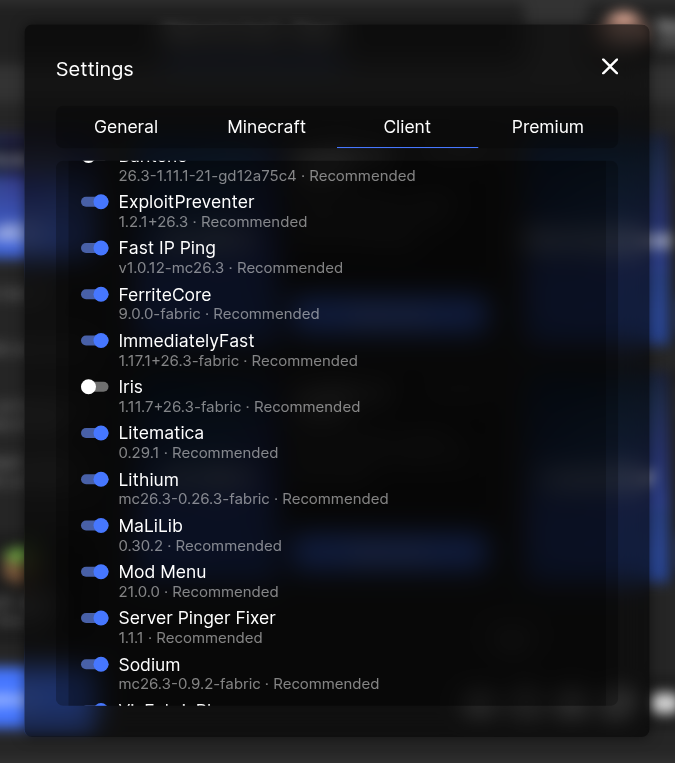
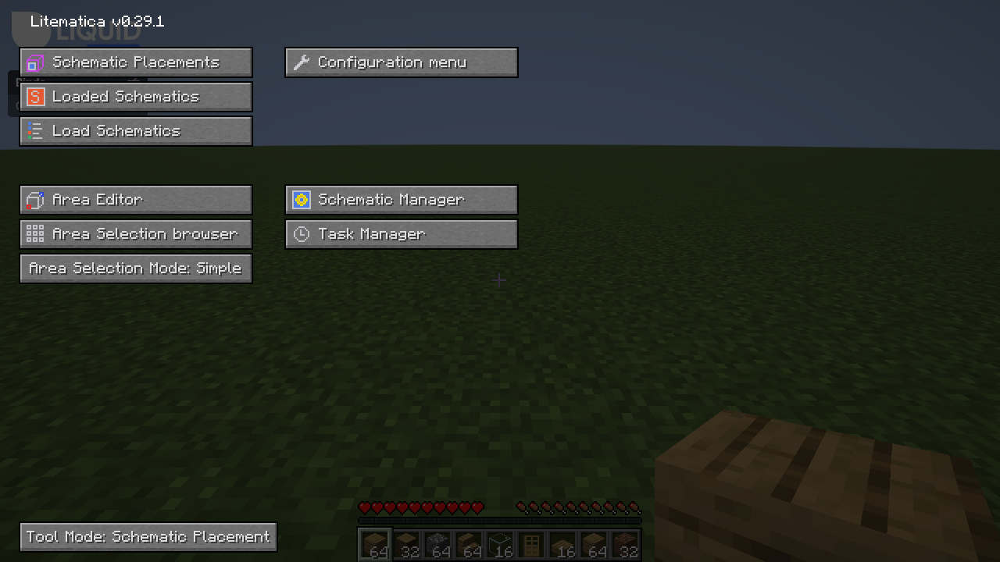
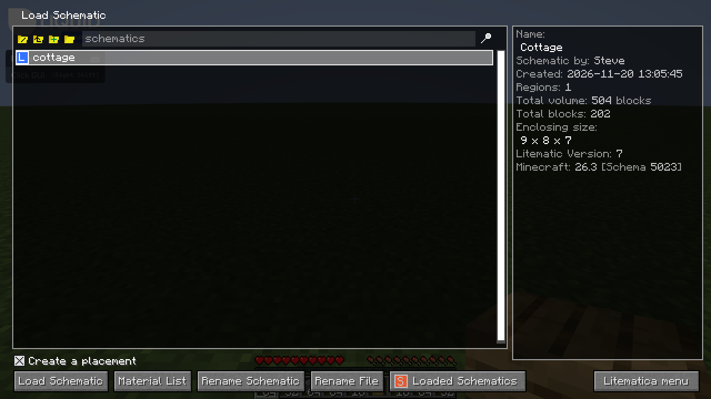
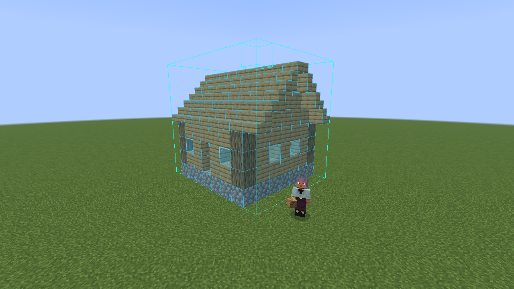
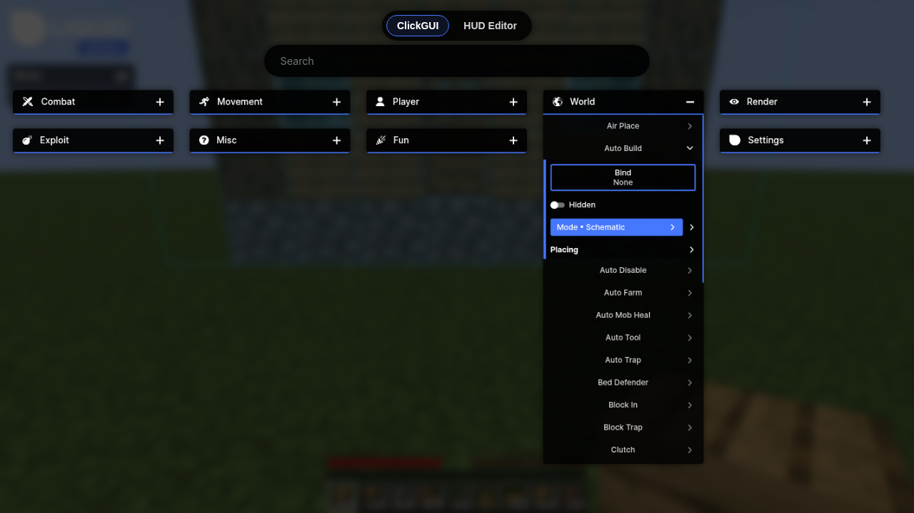
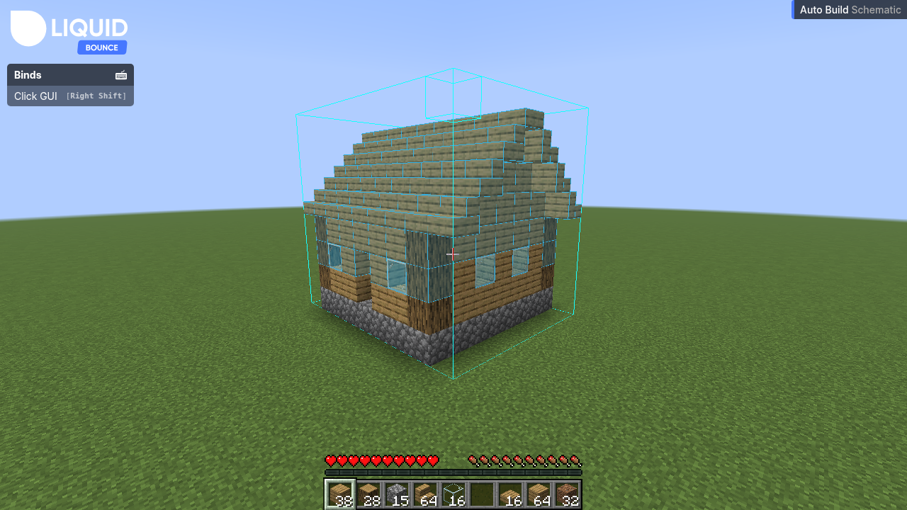

## Building Schematics

[AutoBuild](/docs/modules/world/autobuild) builds a schematic for you in survival. You place the schematic with the Litematica mod, then AutoBuild walks around and puts in every block.

### 1. Install Litematica

In LiquidLauncher, open the settings (the cog next to your account), go to *Client* and turn on **Litematica** and **MaLiLib**.

With another launcher, download [Litematica](https://modrinth.com/mod/litematica) and [MaLiLib](https://modrinth.com/mod/malilib) for your Minecraft version into the *mods* folder.

### 2. Add your schematic

Put your `.litematic` file into the `schematics` folder of your game folder. Create the folder if it is not there.

- LiquidLauncher on Windows: `%APPDATA%/CCBlueX/LiquidLauncher/data/gameDir/nextgen/schematics`
- LiquidLauncher on Linux: `~/.local/share/liquidlauncher/gameDir/nextgen/schematics`
- LiquidLauncher on macOS: `~/Library/Application Support/net.CCBlueX.LiquidLauncher/gameDir/nextgen/schematics`
- Minecraft Launcher: `.minecraft/schematics`

### 3. Place it

Stand where it should be built, press **M** and click **Load Schematics**.

Click your schematic, then **Load Schematic**.

A see-through preview of it shows up at your feet. To move or turn it, press **M** and click **Schematic Placements**, then **Configure**.

### 4. Build it

Open the [ClickGUI](/docs/usage/clickgui) with **Right Shift**, right-click **Auto Build** in the **World** panel, set **Mode** to **Schematic** and turn it on.

Bring every block the schematic needs, a few spare blocks such as dirt, and buckets if it has water or lava. AutoBuild also takes blocks from chests close by. It turns off when it is done and says in chat what was missing.

